# Baranguard — Workflows & Business Rules (Code-Verified)

Purpose: end-user workflows, state machines and the numbered business rules the code and tests cite.
Status / Last updated: 2026-10-28 (rules 97-106 and Part 9, offline sync rules, added that day; earlier audit dates below).

> **Barangay Intelligence and Emergency Dispatch System**  
> Operational reference for Pilar, Sorsogon (Dao, Binanuahan, Marifosque, Banuyo).  
> *Audited and reconciled directly against the backend, web, and mobile codebase on 2026-10-02; updated 2026-10-07 for the Proposed Changes Review decisions and re-checked 2026-10-08 against the code (nav/landing pages in `web/src/main.js` and `AppShell.js`, incident and dispatch rules in `IncidentsController`/`DispatchController`, sync in `SyncController`/`syncService.ts`, offers in `OfferService`) after Gap-X1/X2/X3. Code-complete, verified on disposable databases only; not browser- or device-verified.*

---

# Part 1: End-User Workflows

Baranguard serves **4 end-user personas** (the anonymous citizen form was retired; walk-ins are logged by the Secretary or Admin), each with distinct device interfaces, permission scopes, and responsibilities.

```
+---------------------------------------------------------+
|                  BARANGUARD END USERS                   |
+----------------------------+----------------------------+
| Web Dashboard Users        | Mobile App Users           |
| - Admin (Chief Tanod)      | - Tanod                    |
| - Secretary                | - Admin (Chief Tanod) on   |
| - Punong Barangay          |   phone: SOS + dispatch    |
+----------------------------+----------------------------+
```

---

## 1. Admin (Chief Tanod / Desk Officer)

* **Platform:** Web Desktop (`https://baranguardph.win`)
* **Default Landing Page:** `dashboard`
* **Core Function:** Day-to-day dispatch command, tanod tracking, roster drafting, user provisioning, system health, and Annex D report preparation.

### Complete Navigation Reach (12 sidebar pages + a 4-page "System Tools" group = 16 pages)
`dashboard`, `dispatch`, `incident-management`, `gis`, `approvals`, `accomplishment-reports`, `referrals`, `school-zones`, `analytics`, `personnel`, `settings`, plus **System Tools** (one grouped menu holding `sms-log`, `audit-log`, `service-health`, `map-packages`). No separate technical-admin role exists: the barangay officials operate these themselves. `settings` is unchanged.

### Operational Flow

```mermaid
flowchart TD
    Login["1. Log In (Web)"] --> Dash["2. Admin Dashboard"]
    
    Dash --> Disp["Dispatch Center"]
    Disp --> DispQueue["View Pending Incidents"]
    DispQueue --> DispAssign["Assign On-Duty Tanod (POST /dispatch)"]
    DispAssign --> DispTrack["Monitor Live En Route / Arrived Units"]
    DispTrack --> DispCancel["Cancel Dispatch (mandatory reason; allowed before or after arrival)"]
    DispQueue --> DispReopened["Reopened incidents are queued here too (REOPENED badge) and can be dispatched"]
    DispQueue --> DispOffer["Night / on demand: Broadcast offer to on-duty tanods (first accept wins)"]
    DispAssign --> DispOverride["No published shift? Assign anyway with a mandatory override reason"]

    Dash --> GIS["GIS Live Tracking"]
    GIS --> GISPoll["View Tanod Markers (polls every 15s)"]
    GISPoll --> GISAlert["Identify SOS Alarms & Stale Tanod Units (>120s)"]

    Dash --> IncMgmt["Incident Management"]
    IncMgmt --> IncCreate["Log New Incident or Link to School"]
    IncMgmt --> IncDetail["Open Incident Detail"]
    IncDetail --> IncResolve["Resolve Incident (Admin only; dispatched with zero active dispatches)"]
    IncDetail --> IncResolveND["Resolve without dispatch (Admin only; pending/reopened; mandatory reason)"]
    IncMgmt --> IncDispatch["Dispatch / Resolve buttons are Admin-only (Secretary sees a note instead)"]

    Dash --> PersHub["Personnel Hub"]
    PersHub --> UsersTab["Users: Create / Suspend / Set Title & Authorities"]
    PersHub --> SchedTab["Scheduler week grid: fixed availability shaded, '+' adds a draft shift inside it"]
    SchedTab --> PublishShifts["Print Roster (Signed on Paper Outside the App), Then Publish"]
    PersHub --> SwapsTab["Shift Swaps: Approve or Reject Tanod Swap Requests"]

    Dash --> ApprInbox["Approvals Inbox"]
    ApprInbox --> PaperQueues["Prepared Reports and Draft Rosters to Print and Publish"]

    Dash --> SysHealth["Service Health & Ops"]
    SysHealth --> CheckProbes["Check MariaDB / ORS / GSM Gateway / FCM / Cloudflared"]
    SysHealth --> RunBackup["Inspect Daily Backup & Weekly Restore Drill Telemetry"]
    SysHealth --> SMSMon["SMS Monitor: Inbound Carrier SMS & Bulk Broadcast"]
```

---

## 2. Secretary (Records & Reports Officer)

* **Platform:** Web Desktop (`https://baranguardph.win`)
* **Default Landing Page:** `incident-management` *(Code: `main.js` routes secretary directly here; dashboard is inaccessible to Secretary)*
* **Core Function:** Statutory records custodian (RA 7160 §394c), confidential narrative reviewer, incident lifecycle governor, Safer School Zones administrator, walk-in incident logging, draft rosters and swap review, and paper-approval recording.

### Complete Navigation Reach (7 Sidebar Items)
`incident-management`, `approvals`, `accomplishment-reports`, `referrals`, `school-zones`, `personnel`, `settings`.  
*(Excluded by `PAGE_ROLES`: `dashboard`, `dispatch`, `gis`, `analytics`, `sms-log`, `audit-log`, `service-health`, `map-packages`)*

### Operational Flow

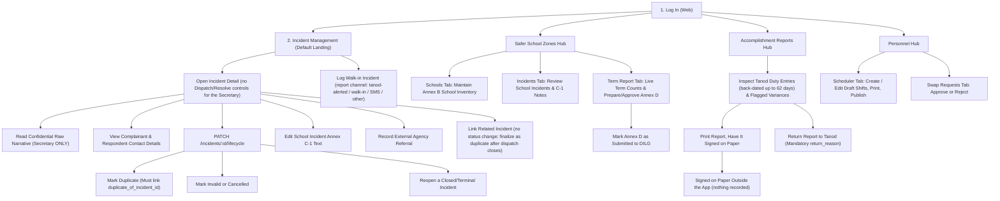

---

## 3. Punong Barangay (oversight)

* **Platform:** Web Desktop (`https://baranguardph.win`)
* **Default Landing Page:** `dashboard` (Read-only executive analytics with pending approvals widget)
* **Core Function:** Executive oversight, high-level intelligence and GIS monitoring, and statutory signing/approval authority for rosters, accomplishment reports, and term submissions.

### Complete Navigation Reach (9 Sidebar Items)
`dashboard`, `gis`, `approvals`, `accomplishment-reports`, `referrals`, `school-zones`, `analytics`, `personnel`, `settings`.  
*(Excluded by `PAGE_ROLES`: `dispatch`, `incident-management`, `sms-log`, `audit-log`, `service-health`, `map-packages`)*

### Operational Flow

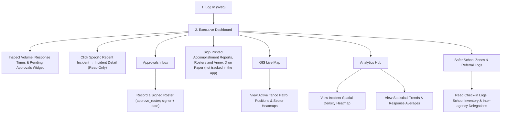

---

## 4. Tanod (Patrol Responder / Field Operative)

* **Platform:** Mobile Android App (Ionic React + Capacitor + SQLCipher encrypted database)
* **Shell Structure:** 5 Persistent Bottom Tabs (`Home`, `Dispatches`, `Report [+]`, `Map`, `Profile`) + Contextual Sub-Pages.
* **Core Function:** Responding to emergency dispatches, emergency SOS panic broadcast, turn-by-turn navigation, photo/audio evidence collection, school zone check-ins, availability submission, and daily accomplishment reporting.

### Operational Flow

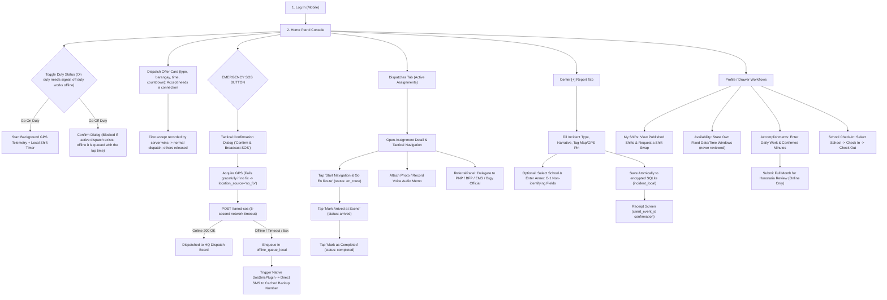

---

## 5. Chief Tanod on the phone (Admin account, one account)

* **Platform:** the same Android app; an Admin login on a phone gets a device session limited to a fixed allow-list.
* **Stage 1 (built):** acknowledge and resolve SOS (resolve added 2026-10-12, online only, after a confirmation), list/assign/cancel dispatches (cancel needs a reason; assigning without a published shift needs an override reason), broadcast or cancel dispatch offers, read incidents. Incident resolution stays on the web dashboard.
* **Not on the phone:** user management, reports, exports, settings, availability, accomplishments.

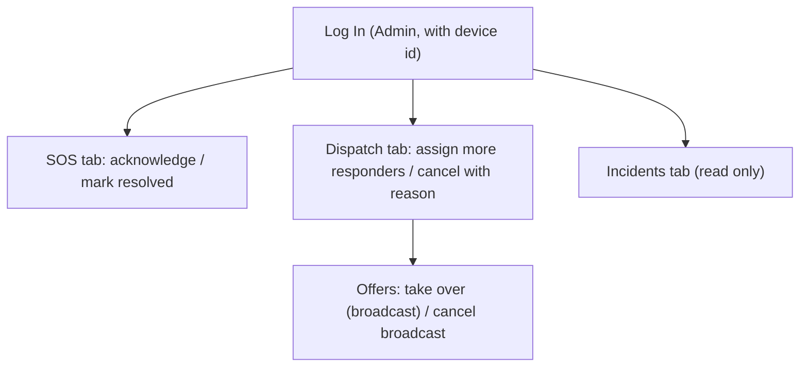

---

# Part 2: Codebase State Machines

Every state machine in Baranguard is strictly validated on the backend. The following tables and diagrams show the exact states, trigger endpoints, and database columns.

---

### 1. Incident Lifecycle & Resolution
* **Database Columns:** `incident.status` (`pending`, `dispatched`, `resolved`, `duplicate`, `invalid`, `cancelled`, `reopened`) and `incident.duplicate_of_incident_id`
* **Authority Gate:** Admin resolves (`/status`): from `dispatched` once no dispatch is open, or from `pending`/`reopened` only with a reason of 1 to 255 characters (stored in `incident.resolve_reason`, never copied to the audit log); Secretary governs records lifecycle (`/lifecycle`). Cancelling the last active dispatch of a `dispatched` incident returns it to `pending`.

```mermaid
stateDiagram-v2
    [*] --> pending : Reported by a Tanod, or logged by the Secretary/Admin (walk-in, SMS, other)
    pending --> dispatched : Admin creates dispatch assignment
    dispatched --> pending : All active dispatches cancelled
    dispatched --> resolved : Admin resolves (Requires ALL dispatches completed/cancelled)
    
    pending --> resolved : Admin resolves with a mandatory reason (no dispatch was needed; migration 0039)
    reopened --> resolved : Admin resolves with a mandatory reason (no dispatch was needed)
    pending --> duplicate : Secretary marks duplicate (Requires duplicate_of_incident_id link)
    pending --> invalid : Secretary marks invalid
    pending --> cancelled : Secretary cancels incident
    
    dispatched --> duplicate : Secretary (Blocked if active dispatch open)
    dispatched --> invalid : Secretary (Blocked if active dispatch open)
    dispatched --> cancelled : Secretary (Blocked if active dispatch open)
    
    resolved --> reopened : Secretary reopens case
    duplicate --> reopened : Secretary reopens case
    invalid --> reopened : Secretary reopens case
    cancelled --> reopened : Secretary reopens case
    
    reopened --> dispatched : Admin dispatches a tanod (a reopened incident is dispatchable like a pending one)
    reopened --> duplicate : Secretary (Blocked if active dispatch open)
    reopened --> invalid : Secretary (Blocked if active dispatch open)
    reopened --> cancelled : Secretary (Blocked if active dispatch open)
```

---

### 2. Dispatch Assignment Status
* **Database Column:** `dispatch.status` (`assigned`, `en_route`, `arrived`, `completed`, `cancelled`)
* **Trigger Endpoints:** Admin creates/cancels (`/dispatch`, `/dispatch/:id/cancel`); Tanod advances (`PATCH /dispatch/:id/status`).

```mermaid
stateDiagram-v2
    [*] --> assigned : Admin assigns Tanod to incident
    assigned --> en_route : Tanod taps 'Start Navigation'
    en_route --> arrived : Tanod taps 'Mark Arrived at Scene'
    arrived --> completed : Tanod taps 'Mark as Completed'
    
    assigned --> cancelled : Admin cancels (Mandatory reason recorded)
    en_route --> cancelled : Admin cancels (Mandatory reason recorded)
    arrived --> cancelled : Admin cancels (Mandatory reason; unblocks a stuck dispatch)
    
    completed --> [*] : Terminal state
    cancelled --> [*] : Terminal state
```

---

### 3. Monthly Accomplishment Report
* **Database Column:** `accomplishment_report.status` (`open`, `prepared`, `returned`; `noted`/`approved` removed by migration 0041)
* **Authority Gate:** Tanod submits (`prepared`, entries locked); the report is printed and signed on paper outside the app, which does not track the signature (Rule 80). An official holding `note_report` or `approve_report` can return it with a reason.

```mermaid
stateDiagram-v2
    [*] --> open : Created for Tanod for month YYYY-MM
    open --> prepared : Tanod submits month (Online only)
    prepared --> returned : Official returns report with return_reason
    
    returned --> prepared : Tanod edits entries & resubmits
    prepared --> [*] : Locked in-system; printed and signed on paper outside the app (not tracked)
```

---

### 4. Shift Schedule & Roster Publication
* **Database Column:** `shift_schedule.approval_status` (`draft`, `published`) plus `pending_reapproval`
* **Authority Gate:** Admin or Secretary creates the draft, prints it (signed on paper outside the app, not tracked) and publishes it with a plain `POST /shifts/publish` (Rule 80).

```mermaid
stateDiagram-v2
    [*] --> draft : Admin creates shift from availability or scratch
    draft --> published : Published via POST /shifts/publish (plain publish; the printed roster is signed on paper outside the app)
    
    published --> draft : Material edit to shift user_id, start_at, or end_at
    published --> published : Shift swap approved (only the name changes; the incoming tanod must be available)
    
    note right of published : Visible on Tanod mobile app
```

---

### 5. Safer School Zones Annex D Term Report
* **Database Column:** `ssz_term_report.status` (`draft`, `prepared`, `submitted`; `approved` removed by migration 0041)
* **Authority Gate:** Admin/Secretary drafts; `prepare_annex_d` prepares; it is printed and signed on paper outside the app (not tracked); Admin/Secretary marks submitted.

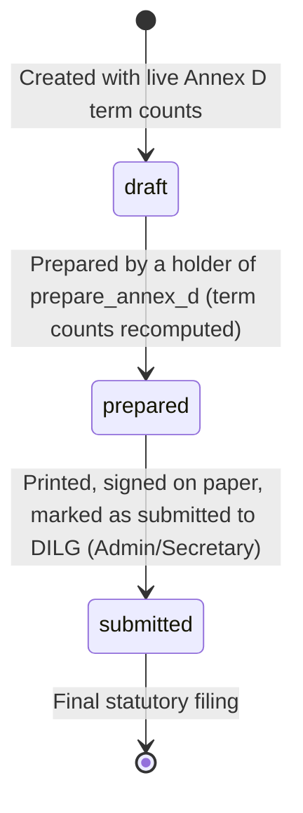

---

### 6. Dispatch Offer (night broadcast)
* **Database Column:** `dispatch_offer.status` (`open`, `escalated`, `accepted`, `closed`, `cancelled`). `closed` means settled without a tanod accepting: an Admin assigned directly, or the incident was resolved/cancelled/merged meanwhile.
* **Trigger:** every new pending incident at night (18:00 to 06:00 Manila) or an Admin/Secretary broadcast on demand; accept is online-only.

```mermaid
stateDiagram-v2
    [*] --> open : Broadcast to on-duty tanods with a published shift (round 1 of 3)
    open --> accepted : First accept recorded by the server wins; others released
    open --> open : 180 s with no accept: next round re-broadcast, Admins alerted
    open --> escalated : Nobody qualifies (no rostered tanod AND no on-duty tanod whose availability covers now) or round 3 expired
    escalated --> accepted : A tanod accepts
    open --> closed : Admin assigns directly (POST /dispatch) or the incident is no longer open
    escalated --> closed : Admin assigns directly (POST /dispatch) or the incident is no longer open
    open --> cancelled : Admin cancels
    escalated --> cancelled : Admin cancels
    accepted --> [*]
    cancelled --> [*]
    closed --> [*]
```

---

### 7. Tanod Emergency SOS Panic Alert
* **Database Column:** `tanod_sos.status` (`active`, `acknowledged`, `resolved`)
* **Trigger Endpoints:** Tanod triggers (`POST /tanod-sos`); Admin acknowledges (`/acknowledge`, also from the Chief Tanod phone); Admin resolves on the web (`/resolve`). An SOS also alerts every on-duty tanod and every active Admin.

```mermaid
stateDiagram-v2
    [*] --> active : Tanod confirms SOS (GPS fix or no_fix)
    active --> acknowledged : Desk Officer acknowledges SOS
    acknowledged --> resolved : Threat neutralized / Officer safe
    active --> resolved : Direct resolution by Desk Officer (web; the phone offers Resolve only after Acknowledge)
    resolved --> [*] : Closed emergency record
```

---

# Part 3: Business Rules (One Sentence Per Rule)

### I. Authentication, Sessions & Tenancy
1. Every authenticated user must supply a valid username and password; there is no anonymous access to any write route (the public citizen form was retired; the public transparency read endpoint remains).
2. An account is locked for 15 minutes after 5 failed login attempts within a rolling 15-minute window.
3. Web sessions use a 15-minute sliding JWT refreshed automatically by dashboard polling, while mobile tanod and Admin (Chief Tanod) device sessions use a 24-hour sliding token capped at 7 days; an Admin device session can only reach a fixed allow-list of endpoints.
4. Logging out, suspension, deactivation, or password changes instantly revoke all active session tokens on the server.
5. All tenant-isolated database queries strictly enforce `barangay_id`, and any cross-tenant request returns a `404 Not Found` rather than a `403` to prevent confirming the existence of resources in other barangays.
6. Server-side middleware validates role, tenant, and resource ownership on every protected endpoint; client-side guards are never treated as security boundaries.

### II. Incident Dispatch & Operations
7. Only an Admin can create a dispatch assignment (for a `pending`, `reopened` or `dispatched` incident), except at night or on demand, when an offer is broadcast to on-duty tanods and the first accept recorded by the server creates the dispatch.
8. A Tanod cannot be dispatched if they are off-duty, already responding, inactive, suspended, or from another barangay, and must hold a published shift covering the current time unless the Admin gives a mandatory override reason.
9. An incident supports multiple concurrent responder dispatches without artificial priority gates.
10. Cancelling an active dispatch (assigned, en route or arrived, always with a mandatory reason) reverts an incident to `pending` only when no other active responder remains assigned.
11. An Admin can resolve a `dispatched` incident only after all its responder dispatches are completed or cancelled; a `pending` or `reopened` incident may be resolved without any dispatch only with a mandatory reason (1 to 255 characters) that is stored on the incident and never written into audit metadata.
12. Only a Secretary can modify an incident's statutory lifecycle to `duplicate`, `invalid`, `cancelled`, or `reopened`.
13. Marking an incident as `duplicate` strictly requires linking it to a target `duplicate_of_incident_id` within the same barangay, preserving both records without deleting or merging data.
14. A terminal incident state (`resolved`, `cancelled`, `invalid`, `duplicate`) can only transition to `reopened` and cannot jump directly to another terminal state.
15. Incident status or lifecycle modifications are rejected with a conflict error if an active dispatch is open; a related-incident link is the exception because it never changes status.
16. Web writes require a UUID `Idempotency-Key` and mobile writes require a `client_event_id`; replayed requests return the original row rather than creating duplicates.

### III. Data Privacy & Statutory Compliance
17. Raw incident narratives are stored encrypted and never transmitted via push notifications, SMS alerts, server logs, or audit metadata.
18. Only a Secretary can view an incident's confidential raw narrative and party contact details; Admins and Punong Barangays receive only non-identifying operational summaries.
19. All raw narratives are permanently purged after a mandatory one-year (365-day) retention ceiling (was 90 days until 2026-10-17, Rule 82).
20. Audit log entries are strictly append-only and record allow-listed entity identifiers and statuses without personal identifiers, narratives, or coordinates.
21. Baranguard strictly functions as an operational dispatch tool and may never be presented as replacing DILG's mandated BIMSS/KPIS case registry.

### IV. Emergency SOS & Field Safety
22. The emergency SOS broadcast must never be blocked by a missing or failed GPS fix; the server records a fallback position or flags the alert as `no_fix`.
23. If the server is unreachable, the mobile app sends a direct emergency SMS to the cached backup contact number via the phone's native SIM.
24. Acknowledging an SOS alert notifies the operator but does not dismiss the visual emergency alert banner until the distress is explicitly marked resolved (on the web, or from the Chief Tanod phone).
25. The SOS mobile trigger opens a tactical confirmation dialog to prevent accidental triggers while guaranteeing immediate transmission upon confirmation.

### V. Scheduling, Rostering & Duty Limits
26. Newly created shifts (by an Admin or Secretary) default to `draft` status and remain invisible on the mobile app until an Admin or Secretary publishes them. The printed roster is signed on paper outside the app, which does not track that (Rule 80).
27. A Tanod cannot be scheduled for more than 12 hours within a single Asia/Manila calendar day.
28. Materially editing a published shift's assigned officer, start time, or end time reverts it to `draft` and revokes its approval. An approved swap does not: the shift stays published with the new tanod (Rule 74). `pending_reapproval` survives only on rows flagged before 2026-10-12.
29. Shift swap requests raised against `draft` shifts return a `404 Not Found` because draft rosters are hidden from field personnel.
30. Missing duty coverage across a patrol zone generates a warning during roster publication but does not block publication.
31. *(Merged into Rule 28; number kept so older citations still line up.)*

### VI. Tanod Availability & Accomplishment Reports
32. A Tanod's availability is their own fixed statement: they can change a period's windows at any time (version +1), and nobody reviews, accepts, revises or locks it (`PATCH /availability/:id` answers 410 `AVAILABILITY_NOT_REVIEWED`). Legacy `accepted`/`revised` rows are history only.
33. The server computes suggested duty durations from recorded `on_duty` intervals and flags any accomplishment entry where the Tanod's confirmed duration differs by more than 30 minutes.
34. Final monthly accomplishment reports must be submitted online and cannot be queued through the offline sync worker.
35. ~~The preparer of an accomplishment report can never note or approve their own report.~~ Dropped 2026-10-17 (Rule 96).
36. Administrators cannot grant or revoke approving authorities on their own user account; changes require action from a second administrator.

### VII. Agency Referrals & External Handoffs
37. Logging an inter-agency referral records an operational handoff to an external body without altering the incident's dispatch status.
38. The referral log exposes only destination agency categories and reference codes, excluding personal identifying information and narrative text.

### VIII. Safer School Zones (DILG MC 2026-037)
39. School check-in timestamps must be valid ISO-8601 strings within 5 minutes in the future and no older than 62 days in the past.
40. School check-out timestamps cannot precede check-in and must occur within 24 hours of arrival.
41. An invalid or inactive `school_id` submitted from mobile is saved as NULL rather than rejecting the offline incident report.
42. Annex D term reports require preparation by an official with `prepare_annex_d` and approval by a separate official with `approve_annex_d` before being marked submitted.
43. School incident records carry short, non-identifying Annex C-1 fields that strictly forbid recording student names or identifying details.

### IX. Mobile Offline Architecture & Sync Queue
44. Every mobile field submission persists immediately to encrypted local SQLite storage before navigation can continue.
45. Mobile synchronization processes queued items in strict priority: SOS alerts first, dispatch updates second, incidents third, workflow items fourth, and GPS breadcrumbs last. *(Reconciled 2026-10-28: there are two real orders. The phone uploads sos, dispatch status, duty status, incidents, referrals, availability, accomplishment entries, school check-ins, then gps (`syncService.ts`). `POST /sync/batch` processes sos, incident, referral, gps, duty_status, dispatch_status, availability, accomplishment_entry, school_checkin within one request (`SyncController.php`); SOS is first in both and incidents precede referrals in both. The server order is the one that applies inside a single batch.)*
46. The mobile app sends sync payloads in chunks of 50 items, the server rejects a batch above 200 items, and GPS breadcrumbs are capped at 200 points per sync pass.
47. Duplicate sync payloads matching an existing `client_event_id` return the existing server row rather than throwing an error.
48. Non-transient client sync rejections revert optimistic local status changes and mark the queue item as requiring attention.
49. Going on duty needs a connection; going off duty works offline and is queued with the phone's tap time, then recorded at that time when it syncs (at most 5 minutes ahead, 62 days back, never before the last on-duty row). An officer cannot go off duty while an active dispatch remains open; a queued off duty the server rejects is reverted and shown to the tanod.

### X. Data Retention, Backup & System Governance
50. Retention rules are enforced as constants in code, and modifications require architectural and council policy approval.
51. GPS tracking breadcrumbs, duty status logs, shift assignments, and notification records are purged after a 1-year retention period.
52. Encrypted database backups run nightly and restore drills execute weekly via automated workstation scheduled tasks.
53. While any legal hold is active, no backup is pruned (this covers every backup existing when the hold was placed and every backup created while it stays active).
54. All server timestamps are stored in UTC, and calendar day calculations use a fixed Asia/Manila (+08:00) offset in PHP rather than SQL timezone conversions.
55. The workstation serves four fixed barangays in Pilar, Sorsogon, and expanding tenant coverage requires schema migrations.

### XI. Review-Decision Additions (2026-10-07)
56. The anonymous public citizen report form no longer exists, and since 2026-10-17 neither does the Citizen Reports inbox (screen, routes and nav item removed; old `citizen_report` rows are kept until their retention date and nothing creates new ones). Resident self-reporting by SMS is future work, not built; walk-ins are logged by the Secretary or Admin and every incident records a report channel from a fixed list (tanod-alerted, walk-in, SMS, other).
57. A dispatch offer goes to active, on-duty tanods with no active dispatch who hold a published shift covering the current time; if none qualifies, it goes to such on-duty tanods whose own availability covers the current time (Rule 77). Its alert shows only incident type, barangay and time.
58. Accepting a dispatch offer is online-only, never queued; the first accept the server records wins, all other recipients are released, and an Admin can still assign additional responders.
59. An offer nobody accepts within 180 seconds re-broadcasts (up to three rounds) and alerts the Admins, then stays escalated with spaced Admin reminders until someone assigns or cancels.
60. At night (18:00 inclusive to 06:00 exclusive, Asia/Manila) every new pending incident opens an offer automatically; during the day the Admin assigns.
61. A related-incident link between two incidents of the same barangay changes no status and may be set while a dispatch is open; the Secretary finalizes a duplicate only after the dispatch closes.
62. A prepared accomplishment report is locked in the system (entries cannot change unless it is returned). It is printed and signed on paper; the paper copy is the official record and the app does not track the signature (Rule 80, which replaces the earlier "paper signature pending" rule).
63. Recording the signed paper is the only approval path (Rule 75). The Secretary or Admin names the signer, who must hold the matching authority and must not be the preparer; for an Annex D draft they also name the preparer. Signer, preparer, date and recorder are stored and audited. **Superseded by Rule 80 (2026-10-12, migration 0041).**
64. A scan attached to a report must be a PDF, JPG or PNG of at most 10 MB, is visible to Admin, Secretary and Punong Barangay, lives as long as its parent report, and must contain no student names.
65. Retention periods for availability, accomplishment reports, school check-ins and referrals are placeholders pending barangay confirmation, so nothing is purged from those tables yet.
66. An Admin (Chief Tanod) may sign in on the mobile app with a device session limited to SOS acknowledgement and resolution, dispatch override and read access.

### XII. Gap-X Additions (2026-10-08)
67. A `reopened` incident is treated like a `pending` one for dispatching and dispatch offers, and appears in the Dispatch Center queue and the GIS active-incident filter.
68. Dispatch and Resolve controls in Incident Management are shown to the Admin only; the Secretary sees a read-only note (the server already enforced this).
69. A draft shift can be created from a tanod's availability; it is prefilled from the tanod's window and is still saved as `draft`. Every shift for a tanod must fit inside their availability (Rule 76).
70. A tanod can capture photo or voice evidence on an assigned incident while offline; it shows as waiting for a connection until the server confirms the upload.

### XIII. Logic-Review Decisions (2026-10-09)
71. An incident that needed no dispatch (a phone call or an on-the-spot walk-in settled it) is closed by the Admin as `resolved` with a mandatory reason, so it is counted as handled and never has to be mislabelled `cancelled`; it has no dispatch and therefore no response time.
72. An SOS is resolved by the Admin on the web dashboard or from the Chief Tanod's phone (online only, after a confirmation, a signed device write). Superseded 2026-10-12; it was web-only before.

### XIV. Paper-First Signing (2026-10-12)
73. The signed paper is the official approval of accomplishment reports, rosters and Annex D. The web dashboard no longer offers separate in-app note/approve clicks: the Admin or Secretary records the signed paper (signer and date), which approves an accomplishment report from `prepared` or `noted`, an Annex D from `prepared`, and publishes draft shifts. The in-app note/approve/publish endpoints are kept, and a Punong Barangay holding `approve_roster` may still publish in-app. **Superseded by Rule 80 (2026-10-12, migration 0041).**
74. A tanod is notified on the phone (ordinary push, no SMS) when their accomplishment report is approved or returned and when shifts assigned to them are published; the message carries only the month and the outcome. Admin and Secretary always see accomplishment entry text, because they print the form that gets signed. Every printed form is A4.

73. The signed paper is the official approval of accomplishment reports, rosters and Annex D. The web dashboard no longer offers separate in-app note/approve clicks: the Admin or Secretary records the signed paper (signer and date), which approves an accomplishment report from `prepared` or `noted`, an Annex D from `prepared`, and publishes draft shifts. Tightened the same day by Rule 75: the in-app endpoints now refuse. **Superseded by Rule 80 (2026-10-12, migration 0041).**


### XV. Workflow-Gap Fixes (2026-10-12)
74. Approving a shift swap keeps a published shift published: only the name changes, `approved_by` stays the original signer, and the incoming tanod must pass the eligibility, overlap, 12-hour and availability checks.
75. In-app approvals are retired: `POST /accomplishment-reports/:id/note` and `/approve`, and `POST /ssz-term-reports/:id/prepare` and `/approve`, answer 410 `PAPER_APPROVAL_REQUIRED`; `POST /shifts/publish` requires `recorded_from_paper` from every caller (422 otherwise). A Punong Barangay holding `approve_roster` may record a signed roster, naming themselves or another holder. Returning a report is unchanged. **Superseded by Rule 80 (2026-10-12, migration 0041).**
76. A shift may only be scheduled inside the assigned tanod's own availability; create, edit and swap approval refuse with 422 `OUTSIDE_AVAILABILITY` otherwise. A window ending 23:59 runs to midnight. Unassigned shifts and Admin (Chief Tanod) assignees are not checked, nor is a patrol-zone-only edit.
77. When no on-duty tanod with a published shift qualifies for a night offer, the offer goes to on-duty tanods (active, same barangay, no active dispatch) whose own availability covers the current time. A fallback accept stores a fixed system reason in `dispatch.override_reason` and audit flags only; the offer escalates only when nobody qualifies either way.
78. An Annex D draft is prepared and approved in one step by recording the signed paper, naming the preparer (`prepare_annex_d`) and the signer (`approve_annex_d`), who must be different people; the term counts are recomputed at that moment. **Superseded by Rule 80 (2026-10-12, migration 0041).**
79. A back-dated off duty that syncs late recalculates the suggested duty durations of that tanod's entries in months still `open` or `returned`.

### XVI. Print-Only (2026-10-12, migration 0041)
80. All reports, rosters and Annex D are printed and signed on paper outside the app; the app does not track signatures. Accomplishment report statuses are `open`, `prepared` (submitted, entries locked, ready to print) and `returned`; Annex D is `draft`, `prepared`, `submitted`. The note, approve, paper-signature and record-paper-approval endpoints and the `document_scan` scans are removed, `POST /shifts/publish` needs no signed-paper record, and the older paper columns and scans are dropped by migration 0041. The authority flags remain. This replaces Rules 62, 63, 73, 75 and 78.


### XVII. Owner decisions 2026-10-17
81. A report's channel records how it reached the barangay: tanod-alerted, walk-in, SMS, **phone call**, **Facebook message** or other (migration 0044). Staff log phone and Facebook reports as incidents; the Citizen Reports inbox no longer exists (Rule 56).
82. Retention is **one year** for every raw narrative (ceiling from creation, was 90 days) and, provisionally, for availability, accomplishment reports, school check-ins, referrals and submitted Annex D reports (`provisional_one_year`, to be confirmed by the barangay and COA). Legal hold still stops any purge, and the `school` inventory is still never purged.
83. Tanod availability is **optional**: the Chief Tanod builds the roster. A tanod who submitted nothing covering the days is not restricted; a tanod who did submit is held to those windows (422 `OUTSIDE_AVAILABILITY`; a submitted period that lists no time for a day counts as a "no"). The scheduler shows no availability bar or warning for a tanod who gave none.
84. A tanod with no mobile data cannot accept a night dispatch offer. The Chief Tanod reaches them by SMS or phone call and **assigns them directly** (direct dispatch needs a reason if there is no published shift). This is a stated limit of the system, not a defect to hide.
85. Approval authority is a **setting on a user**, not a role. The barangay names who holds `note_report`, `approve_report`, `approve_roster`, `prepare_annex_d` and `approve_annex_d` (Punong Barangay, or the Kagawad for peace and order on a Secretary account). No new role is added.
86. The Chief Tanod **directs and dispatches**, on the web and on the phone console, and answers SOS. The Chief Tanod is not a responder: not dispatchable, no offers, no accomplishment entries (assumption A2).
87. The app **does not claim attendance**. A tanod's monthly accomplishment report, printed and signed on paper, is the record; whether the treasurer and COA accept it for honoraria is for the barangay to confirm. No daily check-in is built unless COA requires one.
88. Safer School Zones annexes (B, C-1, D) are a **draft layout** built from the barangay's own forms. The page and every printout say so until the layouts, deadlines and filing frequency of DILG MC 2026-037 are checked against the circular.
---

# Part 4: Scenario Walk-Throughs (for checking)

Each scenario is one realistic story you can follow step by step and compare with the app. "Rules" points to Part 3, "State" to Part 2, "Evidence" to the automated suite that exercises it on a disposable database. None of these has been run in a browser or on a device by an agent (see `docs/HANDOFF.md`). Where a UAT ID is given it comes from the per-role UAT forms `docs/chapter4-instruments/09a`-`09d`.

| # | Scenario | Roles |
|---|---|---|
| 1 | Daytime incident from report to resolution | Tanod, Admin |
| 2 | Night incident: dispatch offer, first accept wins | System, Tanod, Admin |
| 3 | Dispatching without a published shift | Admin |
| 4 | Cancelling a dispatch, and a second responder | Admin |
| 5 | Wrong or duplicate report: Secretary lifecycle and reopening | Secretary, Admin |
| 6 | Resolve guards | Admin |
| 7 | SOS with and without signal or GPS | Tanod, Admin |
| 8 | Roster: availability to published shift, swap and 12-hour cap | Tanod, Admin, Secretary, Punong Barangay |
| 9 | Monthly accomplishment report | Tanod, officials |
| 10 | Annex D term report and school check-in | Tanod, Secretary, officials |
| 11 | Who can read the confidential narrative | All roles |
| 12 | Login lockout, revocation and the Chief Tanod phone | Any, Admin |
| 13 | Referral to another agency | Tanod, Secretary |
| 14 | Offline duplicates | Tanod |

### Scenario 1. Daytime incident from report to resolution
1. A tanod saves a new incident on the phone with no signal. It is written to encrypted SQLite first and shows a receipt (Rules 44, 47).
2. Signal returns. The sync queue sends SOS first, then dispatch status, then incidents, with workflow items and GPS last, in chunks of 50 (Rules 45, 46).
3. The incident appears as `pending` in the Admin's Dispatch Center queue.
4. It is daytime (06:00 to 18:00 Manila), so no offer opens. The Admin presses "Dispatch Tanod" and picks an on-duty tanod who has a published shift covering now (Rules 7, 8, 60). The incident becomes `dispatched`; the dispatch is `assigned`.
5. The tanod taps Start Navigation, then Mark Arrived, then Mark as Completed (`assigned` to `en_route` to `arrived` to `completed`).
6. The Admin resolves the incident. This is allowed only because the incident is `dispatched` and no dispatch is still open (Rule 11).
- **Expected end state:** incident `resolved`, dispatch `completed`.
- **State:** 1, 2. **Evidence:** `verify-sprint3.sh`, `verify-w3-w4-dispatch-gis.sh`. **UAT:** T-01 to T-10, A-03.

### Scenario 2. Night incident: dispatch offer, first accept wins
1. A new incident is created at 22:30 Manila time. Between 18:00 (inclusive) and 06:00 (exclusive) an offer opens automatically (Rule 60). The Admin can also broadcast one by hand in the day ("Broadcast to on-duty tanods").
2. Active, on-duty tanods with a published shift covering now and no active dispatch receive it. If none qualifies, on-duty tanods whose own availability covers now receive it instead (Rule 77). The alert shows only type, barangay and time (Rule 57).
3. Two tanods tap Accept. Accepting needs a connection and is never queued. The server records the first accept as the winner and releases the other (Rule 58).
4. The winner gets a normal dispatch. The Admin can still add more responders.
5. Variation: nobody accepts within 180 seconds. The offer re-broadcasts and alerts the Admins, for up to three rounds, then stays `escalated` with spaced Admin reminders until someone assigns or cancels (Rule 59; reminders at +3, +6, +12 minutes, then every 30, at most 8).
- **State:** 6. **Evidence:** `verify-dispatch-offers.sh` (193 checks at the 2026-10-08 re-run). **Not demonstrated:** two truly concurrent accepts, because the test server is single-threaded.

### Scenario 3. Dispatching without a published shift
1. The Admin tries to assign a tanod who has no published shift covering the current time.
2. The server refuses with `NO_PUBLISHED_SHIFT`.
3. The Admin enters an override reason and assigns anyway. The reason text is stored, but its content is never written to the audit log (only that a reason existed and its length).
4. Assigning a tanod who is off duty, already responding, suspended, inactive or from another barangay is refused regardless (Rule 8).
- **Evidence:** `verify-wave1a-dispatch-roster.sh`. **UAT:** A-03, A-04, A-05.

### Scenario 4. Cancelling a dispatch, and a second responder
1. The Admin assigns tanod A, then presses "Add Responder" and assigns tanod B (Rule 9).
2. The Admin cancels tanod A's dispatch with the reason left empty. It is refused; a reason of 1 to 255 characters is required (Rule 10).
3. With a reason entered, A's dispatch becomes `cancelled`. B is still active, so the incident stays `dispatched`.
4. The Admin cancels B after B has marked arrived. This is allowed (cancel works from `arrived`). Now no responder is left, so the incident returns to `pending`.
- **State:** 1, 2. **Evidence:** `verify-second-responder.sh`, `verify-wave1a-dispatch-roster.sh`. **UAT:** A-06, A-07, A-08.

### Scenario 5. Wrong or duplicate report: Secretary lifecycle and reopening
1. A walk-in reports a fire already logged by a tanod. The Secretary opens the second incident and chooses Mark as duplicate without choosing the original. It is refused: a duplicate must link a `duplicate_of_incident_id` in the same barangay (Rule 13).
2. A dispatch is still open on it. The change is refused with a conflict (Rule 15). After the dispatch closes, marking it duplicate with the link works. Nothing is deleted or merged; both records stay (Rule 13).
3. While a dispatch is still open the Secretary can still use "Link related incident", because it changes no status (Rules 15, 61).
4. A `resolved`, `duplicate`, `invalid` or `cancelled` incident can only go to `reopened`; it can never jump to another terminal state (Rule 14).
5. After the Secretary reopens an incident, the Admin sees it in the Dispatch Center queue with a REOPENED badge and can dispatch it like a pending one (Rule 67). The Secretary sees no Dispatch or Resolve buttons, only a note (Rule 68).
- **State:** 1. **Evidence:** `verify-h16-incident-lifecycle.sh` (47 checks, includes the reopened-dispatch case). **UAT:** S-04 to S-08, A-18, S-20.

### Scenario 6. Resolve guards
1. The Admin resolves a `pending` incident that was never dispatched. Without a reason it is refused with a 400. With a reason (for example "Settled by phone call") it succeeds, the reason is stored on the incident and the audit log records only that a reason existed and its length (Rule 71). A Secretary cannot resolve at all.
2. The incident is dispatched but a tanod is still `en_route`. Resolve is refused because it still has an active dispatch.
3. After all dispatches are `completed` or `cancelled`, resolve succeeds.
4. A reopened incident may be dispatched and then resolved as above, or resolved directly with a reason.
- **Rules:** 11, 71. **Evidence:** `verify-h16-incident-lifecycle.sh` (59 checks, step 19), `verify-sprint1-remaining.sh`; web test in `web/tests/pages/incident-management.test.mjs`.

### Scenario 7. SOS with and without signal or GPS
1. Online with GPS: the tanod presses SOS and confirms ("Confirm & Broadcast SOS"). The server stores it `active`, and on-duty tanods and every active Admin are alerted.
2. Online without a GPS fix: the SOS is still accepted. It uses the tanod's last known position, or is stored with `location_source = no_fix` and no coordinates (Rule 22).
3. No signal (or the server times out after 5 seconds): the SOS is queued locally and the phone sends a direct SMS to the cached backup contact through its own SIM (Rule 23). The app shows a badge for the SMS result (`sent_by_sms`, `sms_pending`, `sms_failed`).
4. The Admin acknowledges (`acknowledged`) from the web or from the Chief Tanod phone console. Acknowledging does not clear the alert; only an explicit resolve does (Rule 24). The resolve can be done on the web or, after a confirmation, from the Chief Tanod phone (Rule 72).
5. On the web the Admin (or the Secretary) can resolve an `active` SOS directly. On the Chief Tanod phone, Resolve is offered only after Acknowledge (Rule 72).
6. If nobody acknowledges, the SOS is re-sent every 2 minutes (Rule 99).
- **State:** 7. **Evidence:** `verify-sprint4.sh`. **Device-verified once (2026-09-24):** the successful `sent_by_sms` path only; the `sms_failed` path and the no-GPS change are code-only. **UAT:** T-05 to T-08.

### Scenario 8. Roster: availability to published shift, swap and 12-hour cap
1. The tanod states their available windows for a period on the phone (Availability). They can change them at any time (the version goes up). Nobody reviews or locks them (Rule 32).
2. The Admin or Secretary schedules only inside those windows; a shift outside them is refused with `OUTSIDE_AVAILABILITY` (Rule 76).
3. In Personnel, Scheduler (week grid), the Admin presses "+" in the tanod's day cell. The chosen standard shift is saved as `draft`, linked to the availability that covers it (Rules 26, 69). The tanod cannot see it yet.
4. Scheduling the same tanod for more than 12 hours in one Manila day is refused with `DAILY_HOURS_EXCEEDED` (Rule 27). Missing coverage is only a warning at publish (Rule 30).
5. The Admin or Secretary prints the schedule; the officials sign it on paper outside the app (not tracked). The Admin or Secretary then publishes the week. The shift becomes visible to the tanod (Rules 26, 80).
6. A swap request on a `draft` shift returns 404 (Rule 29). On a published shift the swap goes to the Admin or Secretary for review.
7. Changing the tanod, start or end of a published shift reverts it to `draft` (Rule 28). An approved swap keeps it published with the new tanod, who must be available for it (Rules 74, 76).
- **State:** 4 and the availability appendix below. **Evidence:** `verify-roster-accomplishment.sh` (332), `verify-scheduler.sh`. **UAT:** S-19, A-19, P-05. **Not demonstrated:** the 12-hour cap under real concurrent writes.

### Scenario 9. Monthly accomplishment report
1. During the month the tanod enters daily work on the phone with a confirmed duration of 1 to 1440 minutes. A work date in the future or more than 62 days back is refused (Rule 33).
2. The server stores its own suggested duration from on-duty time. If the two differ by more than 30 minutes the entry is flagged for the approver (Rule 33).
3. The tanod submits the whole month online. It cannot be queued offline (Rule 34). Status goes `open` to `prepared`.
4. The Admin or Secretary prints the submitted (`prepared`) report and the officials sign it on paper. Nothing about the signature is recorded in the app (Rule 80).
5. An official who disagrees returns it with a reason (1 to 255 characters). The tanod edits and resubmits.
6. A prepared report is locked, and the paper copy is the official record; the app does not track its signature (Rules 62, 80).
7. An Admin cannot grant or remove their own `approve_*` authorities; a second Admin must (Rule 36).
- **State:** 3. **Evidence:** `verify-roster-accomplishment.sh`. **UAT:** P-06.

### Scenario 10. Annex D term report and school check-in
1. The tanod checks in at a school on the phone and later checks out. A check-in time more than 5 minutes ahead or more than 62 days back is refused. A check-out before the check-in, or more than 24 hours after it, is refused (Rules 39, 40).
2. The Secretary maintains the school list (Annex B). On an incident the school link and the short Annex C-1 text are stored apart from the narrative, with no student names (Rule 43). On a mobile report an unusable `school_id` is saved as empty so the offline report still goes through (Rule 41).
3. The Secretary or Admin creates the Annex D term report from live term counts (`draft`) and a holder of `prepare_annex_d` prepares it (`prepared`). It is printed and signed on paper outside the app (not tracked), and the Secretary or Admin marks it submitted (Rules 42, 80).
- **State:** 5. **Evidence:** `verify-school-zones.sh` (213). **UAT:** S-10 to S-12, P-07. **Open:** the circular's deadlines and Annex A are unknown, so no deadline is hardcoded.

### Scenario 11. Who can read the confidential narrative
1. The Secretary opens an incident detail: the raw narrative and party contacts are shown (Rule 18).
2. The Admin opens the same incident: no narrative and no party contacts.
3. The Punong Barangay opens it from the dashboard: operational summary only, read-only.
4. A user from another barangay requests the same incident id: the answer is `404`, never `403` (Rule 5).
5. The narrative never appears in push notifications, SMS, logs or audit metadata (Rule 17), and is purged at one year (Rules 19, 82).
- **Evidence:** `verify-sprint7-pentest-incidents.sh`, `verify-b2-pentest-remaining-resources.sh`, `verify-sprint7-audit.sh`. **UAT:** S-03.

### Scenario 12. Login lockout, revocation and the Chief Tanod phone
1. Five wrong passwords lock the account for 15 minutes (Rule 2).
2. An Admin suspends a user. The user's very next request fails, because the session is checked on every request (Rule 4).
3. A tanod logging in on a registered phone gets a 24-hour sliding device session capped at 7 days. A web login gets a 15-minute sliding token (Rule 3).
4. The Admin logs in on the phone with a device id. The session works only for the fixed allow-list (SOS acknowledge, dispatch assign and cancel, offers, read-only incidents). Anything else returns 403 `DEVICE_SESSION_SCOPE` (Rule 66).
- **Evidence:** `verify-auth-lockout-revocation.php`, `verify-device-session.sh`, `verify-chief-tanod-mobile.sh` (174). **UAT:** C-01 to C-06.

### Scenario 13. Referral to another agency
1. At a fire the tanod opens the assignment, taps "Refer This Case", chooses BFP (or EMS, PNP and so on) and records it (Rule 37).
2. The dispatch and incident status do not change. The record means "handed over", not "accepted".
3. The Secretary, Admin and Punong Barangay see it in the Referral Log: incident, type, agency, time and reference only, with no names or narrative (Rule 38).
- **Evidence:** `verify-referrals.sh` (147). **UAT:** T-27, P-08.

### Scenario 14. Offline duplicates
1. A tanod saves an incident, loses signal mid-upload and the app retries.
2. The retry carries the same `client_event_id` and `X-Device-Id`. The server returns the original row and creates no second incident (Rule 47).
3. A web write retried with the same `Idempotency-Key` behaves the same way (Rule 16).
4. If the server permanently rejects a queued item, the optimistic local change is reverted and the item is marked as needing attention (Rule 48).
- **Evidence:** `verify-sprint3.sh`, `verify-f5`, `verify-f6` and `verify-f8` suites. **Not device-verified:** offline durability across a real app kill or reboot.

---

## Appendix: Availability states (not in Part 2 above)
```mermaid
stateDiagram-v2
    [*] --> submitted : Tanod submits windows for a period
    submitted --> submitted : Tanod changes the windows (version +1); nobody reviews it (2026-10-12)
    note right of submitted : Legacy accepted/revised rows go back to submitted when the tanod changes them
```

## What did not fit, found during this re-check
- The old incident diagram allowed `pending` to `resolved` and `reopened` to `pending`; the code allows neither (fixed in Part 2).
- Rule 24 (acknowledge does not clear the alert banner) and the SOS fallback badge states describe UI behaviour read from the project docs, not re-run.
- The accomplishment return reason and the 62-day back-date limit are in the scenarios and in Rule 33 only partly; they have no rule of their own.
- Retention for the new tables is undecided (Rule 65), so no scenario can say when that data is deleted.


---

# Part 5: Logic Review (does the whole thing hang together?)

Reviewed 2026-10-08 by reading the rules against each other and against the code; the decisions below were taken 2026-10-09. Each item is now either **fixed in code**, a **stated rule**, or a **stated assumption with an owner**. Nothing here is open silently.

### Consistent (checked, no contradiction found)
- **Authority is layered and non-overlapping:** the Admin owns dispatch and resolution, the Secretary owns the record lifecycle and narrative, approvals follow a separate authority attribute, and the Punong Barangay is oversight plus approval (Rules 7, 12, 18, 26, 35).
- **Time rules agree:** UTC storage, fixed +08:00 days, the night window, the 12-hour cap and school check-in limits all use the same Manila day (Rules 27, 54, 60).
- **Every offline write has a duplicate guard** (`client_event_id` or `Idempotency-Key`), and the things that must not be queued (duty toggle, month submit, offer accept) are the ones that need a live server answer (Rules 16, 34, 49, 58).
- **Privacy rules do not conflict:** the narrative is Secretary-only, never leaves the system, is purged at one year, while the incident row keeps for its own period (Rules 17 to 20).

### Fixed or decided
| # | Finding | Outcome |
|---|---|---|
| 1 | No honest way to close an incident that needed no dispatch | **Fixed in code.** Admin resolves `pending`/`reopened` with a mandatory reason (Rules 11, 71). Migration `0039_incident_resolve_reason`, `IncidentsController::updateStatus`, web "Resolve without dispatch" button, `verify-h16` step 19, one web test. **Note:** Master Reference §6 still says only a dispatched incident can be resolved; by the project rule it should be corrected (open). |
| 2 | SOS resolve is web-only | **Reversed 2026-10-12.** The Chief Tanod phone can resolve (Rule 72). |
| 3 | Separation of duties is per account, not per person | **Assumption A1** (below). |
| 4 | A rostered Chief Tanod has no operational effect | **Assumption A2.** |
| 5 | Offers need a published shift but direct dispatch can override | **Fixed 2026-10-12.** Availability fallback for offers (Rule 77); A3 narrowed. |
| 6 | A tanod cannot go off duty while offline | **Fixed 2026-10-12.** Offline off duty (Rule 49); A4 narrowed. |
| 7 | Legal hold stops all backup pruning, so backups grow | **Assumption A5.** |
| 8 | 1-year purge of shifts and duty data may delete evidence before a COA-facing report period is decided | **Assumption A6** (blocks Rule 51 sign-off). |
| 9 | Narrative purge period not policy-confirmed | One year set 2026-10-17 (Rule 82); still **Assumption A7**. |
| 10 | A reopened incident keeps closing history only in the audit log and timeline | **Assumption A8.** |

### Stated assumptions (each needs an owner to confirm; none changes behaviour)
- **A1 (owner: barangay and thesis adviser).** The preparer rule and the no-self-edit rule are enforced per account. A second Admin can grant approving authority, and one person could hold two accounts. The design assumes honest staffing in a four-barangay setting; state this in the thesis limitations.
- **A2 (owner: Chief Tanod).** The Chief Tanod can be rostered so their presence is recorded, but is never dispatchable, receives no offers and cannot enter accomplishments. If the Chief Tanod should respond to incidents, that is a new decision.
- **A3 (owner: Chief Tanod).** Direct dispatch may override a missing published shift with a free-text reason. Night offers reach a tanod without a published shift only through the availability fallback (Rule 77), which stores a fixed system reason. An on-duty tanod with neither a shift nor availability covering now is never offered a night incident.
- **A4 (owner: developer, tested on a device).** Off duty works offline since 2026-10-12 (Rule 49) and is recorded at the phone's tap time. The remaining assumption is that the phone clock is right to within 5 minutes; a clock further ahead is rejected. Not device-verified.
- **A5 (owner: barangay, storage).** While any legal hold is active no backup is pruned (Rule 53), so backups grow without limit. Give every hold a review date and watch the backup disk.
- **A6 (owner: barangay, treasurer, COA).** Retention for accomplishment reports and Annex D is undecided (Rule 65), while shifts and duty status purge at 1 year (Rule 51). Decide the report periods first, then check Rule 51 against them.
- **A7 (owner: barangay council).** Every raw narrative expires at one year (was 90 days until 2026-10-17) because no approved-redaction path exists (Rule 19). Consistent with the barangay keeping its own binder, but it needs written confirmation.
- **A8 (owner: developer).** After `resolved`, `reopened` and `dispatched`, only the audit log shows the earlier closure. Point readers of an incident at its timeline.

### Still open (not logic, but found while doing this)
- Master Reference §6 (`docs/Baranguard_Master_Reference_FINAL .md`) still states only a dispatched incident can be resolved. Per `CLAUDE.md` the Master Reference is the authority unless corrected, so reconcile it with Rule 11.
- Migrations 0029 to 0039 are not applied to the real databases.

---

# Part 6: Rules added by the 2026-10-09 web audit fixes

73. The Punong Barangay's `GET /incidents` and `GET /dispatch` return only open items plus the last 30 days, no free-text search and no paging beyond page 1, with free-text location, officer name and C-1 text removed; `GET /search` matches an exact id or display id only (constant `PB_LIST_WINDOW_DAYS`).
74. Reports and the weekly digest are labelled system-generated and unsigned; a person signs on paper under a blank "Reviewed and approved by" block. No sworn statement or attestation is ever pre-filled.
75. The response-time figure is shown only as "incident reported to first Tanod arrival" with its sample size; no target is displayed until the barangay adopts one, and it is never a ranking of tanods.
76. A health badge shows `configured` (neutral) when only configuration exists; HEALTHY needs a real probe.
77. The web dashboard signs out after 15 minutes without input (named constant `IDLE_TIMEOUT_MS`) and on any 401; it honours an API base override only on localhost or `https://api.<this site>` (or the page's own host on a port).
78. A paper note and approval may be recorded together for a report still at `prepared` when the noter holds `note_report`, the signer holds `approve_report`, and neither is the preparer. **Superseded by Rule 80 (2026-10-12, migration 0041).**
79. Operational times shown on the web are formatted by `web/src/utils/manilaTime.js` in Asia/Manila, 12-hour; incident and dispatch statuses are labelled by `web/src/utils/statusLabels.js` (pending = Pending, dispatched = Responding).


---

# Part 7: Rules from the owner's workflow review, 2026-10-17

89. *(2026-10-28: for SOS only, an unacknowledged alert now also reaches the Secretary and Punong Barangay from round 3, Rule 99; offers stay Admin-only.)* **The Secretary is the back-up dispatcher.** Besides the Chief Tanod (Admin), the Secretary may open the Dispatch Center, assign a tanod, cancel a dispatch, open or cancel a night offer, acknowledge and resolve an SOS, and resolve an incident, all on the web. Everything else the Secretary could not do before is unchanged: the Secretary still owns the records lifecycle and the complainant name, and still gets no phone device session (Rule 12 stands). The Admin sees contact numbers; the Secretary sees the tanod list without them. SOS and offer alerts still go to the Admin accounts only.
90. **The Chief Tanod can log an incident from the phone**, with the report channel (phone call, Facebook, walk-in, SMS or other). The report is written to the phone's encrypted store first, sent with its own idempotency key (a signed write, `POST /incidents`), and deleted from the phone once the server confirms. The console never shows the narrative back (Rule 1). Sending happens while the app is open; there is no background job for the console.
91. **A referral may go to the Lupon / Katarungang Pambarangay** (`lupon_kp`, migration 0045). It is a delegation record only: date, office, reference number. It counts as barangay-level in Annex D, like a barangay official or the VAW desk. The case itself stays in the barangay's binders and the DILG BIMS.
92. **One workstation per barangay**, each with its own database and its own tunnel hostname if one is used. Dao, Binanuahan, Marifosque and Banuyo are separate deployments; the tenant separation inside the database remains as a second safeguard. Nothing in one barangay's data is visible from another's.
93. **Power and connection cuts (a written procedure is not kept; deployment-only)** call for: a UPS for the workstation and router, an offsite encrypted backup, a paper logbook while the system is down, and entry of the paper incidents afterwards.
94. **Kept as is, by decision:** night dispatch offers are accepted online only (first accept wins, unchanged); dispatch still needs a published shift or an override reason; residents cannot report directly, staff log every report with its channel; tanods use their own mobile data, so no low-data mode or load allowance is built.
95. **Kagawads have no account.** They sign printed reports and rosters on paper, which is already how approval works. The earlier idea of a Secretary account carrying approval authority for a Kagawad is dropped.
96. **The Approval authority dialog is removed (2026-10-17).** There is nothing to configure: the Chief Tanod (Admin) and the Secretary hold every sign-off right by role (publish a roster, return an accomplishment report, prepare Annex D), and the preparer may also publish, return or file their own document (the Punong Barangay's signature on the paper is the check; the record keeps who prepared it and the audit log who acted). The Punong Barangay oversees and holds none; a value written into `user.approval_authority` by hand is still honoured for that role, but no screen sets it. The Users tab lost its "Title & authority" column. The columns `official_title` and `approval_authority` stay in the database (migrations are never edited). This replaces the Admin-managed authority attribute described in REFERENCE.md §3.


---

# Part 8: Rules from the 2026-10-28 mobile and messaging audit fixes

Source: the 2026-10-28 audit (findings in `docs/RISKS_AND_DEFECTS.md`) and `backend/DEVLOG.md` 2026-10-28. Code in the working tree, verified on disposable DBs, vitest and jsdom only; not device-verified, Gradle not run, no new migration.

97. **SOS is reachable from every Tanod tab.** Home keeps its own SOS dock; every other Tanod tab shows a compact SOS control (`SosHoldButton`) that needs a hold of 800 ms and then opens the same confirm sheet. The phone waits at most 2 seconds for a GPS fix (`utils/sosPosition.ts`) and then sends with what it has; the server fills in the last known position or `no_fix` (Rule 22). The SMS fallback still runs when the local queue write fails. **Silent SOS** (vibrate only, no siren) is a checkbox on the confirm sheet, stored on the phone, **silent by default** (owner to confirm that default).
98. **Critical alerts queue instead of overwriting.** The phone keeps a queue of critical alerts ordered by severity (SOS first); each has its own tray notification id; lock-screen text is generic (no names, no coordinates). The server sends `sos`, `priority_alert`, `dispatch` and `dispatch_offer` pushes as **data-only FCM** so the native service runs when the app is closed; other types keep the ordinary notification block. A failed acknowledge is still not retried (open item).
99. **An unacknowledged SOS is repeated.** While a SOS is `active`, `SosEscalation` (run by `notification-worker.php`) creates a new `sos` notification every 2 minutes for up to 5 rounds in the first hour. Round 2 repeats to the active Admin(s); from round 3 the active Secretary and Punong Barangay are added (they have no phone app, so they are reached by SMS). This widens the Rule 89 recipient list for SOS only; dispatch offers stay Admin-only. The Rule 89 scope for SOS is an owner decision still to be confirmed.
100. **SMS status never overclaims.** `pending` means the gateway phone did not confirm within the wait; SMS Monitor shows it as "Sent, not confirmed". `sent` is shown as "Sent" (the gateway only knows the SIM accepted it). **Nothing is ever shown as "Delivered"**, because no carrier delivery report is collected. `queued` shows "Waiting to send". A `pending` send is not retried automatically, to avoid duplicate SOS or dispatch texts.
101. **Inbound texts are stored.** The ingest daemon posts human texts to `POST /internal/sms/inbound-text` (loopback and token only); they are filed under `GATEWAY_BARANGAY_ID` (or the only barangay in the database; with more than one and no setting the call fails, Rule 92) as `sms_log` rows with `direction='inbound'`, the sender number and the message body, so SMS Monitor Conversations and unread counts work. A rejected SOS envelope is logged as `rejected` with **no body**. A text of STOP, STOP ALL, UNSUBSCRIBE, TIGIL or HUWAG NA opts that number out of the advisory list (`sms_subscriber.opted_out_at`); no confirmation reply is sent yet.
102. **Broadcasts are queued.** `POST /sms/broadcast` writes `queued` rows and answers `{recipient_count, queued}` at once; `notification-worker.php` sends them. The same text to the same audience within 10 minutes under a new Idempotency-Key is answered as a duplicate and not sent again. At most 100 recipients per broadcast; the 5 per hour per barangay limit stays. Own barangay only.
103. **Message text is readable and short.** Dispatch, offer and priority messages name the incident type in words (not the enum), carry the barangay and `Ref: INC-YYYY-NNN`, are written in GSM-7 so a message stays in as few segments as possible, and the push versions carry no names and no coordinates. The SMS text of an SOS still names the tanod and gives a position; whether to keep names and coordinates there is an owner decision.
104. **Sign-out cleans the phone.** Logout stops the patrol location service, clears the session and scopes the local lists (incidents, dispatches, availability, schools, evidence) to the signed-in user, so a second user on the same phone does not see the first user's data. The release APK has `allowBackup` off and blocks cleartext HTTP; cleartext is allowed only in a debug build (`CAP_LOCAL_DEV=1 npx cap sync android` for local development).
105. **My Shifts has an offline copy.** The last published shifts and swap requests are cached on the phone (`shiftCache.ts`, Capacitor Preferences, not the encrypted SQLite) and shown read-only with "Offline. Showing your saved schedule from <time>" when the workstation cannot be reached. Swap requests still need a connection (Rule 94).
106. **Background jobs are scheduled.** `install-scheduled-backup-jobs.ps1` registers `BaranguardNotificationWorker` (every minute: push ack timeouts, queued broadcasts, SOS escalation) and `BaranguardGsmIngest` (at logon: inbound SMS daemon), beside the existing tasks; `start-baranguard.ps1` also starts the ingest daemon. `GET /dispatch-offers` and its list carry `server_time` so the phone computes offer countdowns against the server clock, not its own.


# Part 9: Offline sync and conflict rules

Purpose: how the mobile offline queue and sync resolve conflicts, rule by rule (merged here from WORKFLOWS_AND_RULES.md on 2026-10-28; rules written 2026-10-10).


Scope: thesis objective 2 (offline-first Tanod app that captures incidents without internet and synchronises on reconnect). Written 2026-10-10 from the code, not from the design documents. Where the two differ, the code is described.

Status legend:
- **T** = implemented and tested. The test is `backend/scripts/verify-offline-sync-conflicts.sh` (93 checks, run 2026-10-10, 93 pass, against a disposable MariaDB 10.11 and PHP 8.3 built-in server) unless another script is named.
- **I** = implemented, not tested.
- **GAP** = not handled. A GAP row is also marked T when the script pins the current (undesirable) behaviour.
- **UNK** = unknown, needs a device test.

The mobile client was **not** executed. Every client-side statement comes from reading `mobile/src/services/*` and is therefore at most "I".

### 1. How a batch is processed (the mechanism)

- One request, `POST /sync/batch`, Tanod role only (`SyncController::batch`). `device_id` in the body must be an active `mobile_device` owned by the authenticated user, otherwise the whole request is 422 with no per-item results.
- Each item is processed independently (`SyncController::processItem`), with no batch-wide transaction. Result per item: `success`, `duplicate` or `failed` (+ `reason`). Items are never rolled back because a different item failed.
- Server idempotency ledger: table `offline_queue`, unique on (`device_id`, `client_event_id`). A ledger row in `success` means any later item with that event id is answered `duplicate` without being looked at. A row in `pending` or `failed` is re-evaluated on the next send.
- The business tables have their own unique keys as well (incident: device+event; gps, sos, duty_status, referral, availability, accomplishment, school check-in: user+event), as a second line.
- Conflict policy in one sentence: there is **no merge and no last-write-wins**. The first stored write stays; a replay never changes it; a state-dependent write (dispatch status) is applied only if it is still a legal next step on the server's *current* state, otherwise that item is `failed`.
- Processing order on the server: sos, incident, referral, gps, duty_status, dispatch_status, availability, accomplishment_entry, school_checkin; within a kind, in the order the client listed them (`SyncController::batch`, `$order`).
- Limit: 200 items per request across all kinds (`MAX_ITEMS_PER_BATCH`).

### 2. Scenarios x behaviour x status x evidence

| # | Scenario | What happens | Status | Evidence |
|---|---|---|---|---|
| 1a | Same incident event sent twice (even with edited content) | 2nd answer `duplicate`; stored row unchanged (first write wins) | T | `SyncController::processItem`, `IncidentsController::createMobileItem`; script step 1 (and `verify-sprint3.sh` step 3) |
| 1b | Same dispatch-status event sent twice | 2nd answer `duplicate` through the `offline_queue` ledger (the `dispatch` table has no client_event_id); one audit row only | T | `SyncController` class doc + `processItem`; script step 1 |
| 1c | Same SOS event twice (sync, or sync after SMS/direct POST) | one `tanod_sos` row, 2nd `duplicate` | T (sync twice). SMS-then-sync correlation: I | `TanodSosController::createItem`; script step 1 |
| 1d | A different kind of item reusing an already-used event id (UUID collision) | answered `duplicate` and **not stored** (ledger ignores payload kind) | T (behaviour pinned; collision is improbable) | `processItem`; script step 1 |
| 1e | Response lost after the server stored the item, client resends | `duplicate`; client marks it synced | T (server side, `verify-sprint3.sh` "interrupted-sync resume"); client marking: I | `syncService.ts` `syncChunk` |
| 2 | Incident created offline while the same incident was changed/dispatched/resolved on the server | Only the *create* can arrive offline (the phone has no incident-edit path in the sync batch). If the server row exists, the create is `duplicate` and the server row is untouched (not reopened, not overwritten). An incident that is genuinely new is created as `pending`/`normal`, with the server's own id, display id and `created_at` | T for replay. The server-side change was made by SQL in the test, not through the Admin API | `createMobileItem` (`INSERT ... 'pending'`); script step 2 |
| 2b | Offline incident whose optional `school_id` went stale on the server | stored with `school_id = NULL` instead of failing | I | `createMobileItem` (`validateSchoolId(..., false)`) |
| 3a | Dispatch status arrives after Admin **cancelled** | `failed`, reason "Cannot transition from cancelled to ...". Dispatch stays cancelled. Ledger row `failed`. Resending the same event gives `failed` again | T | `DispatchController::applyStatusTransition` (`STATUS_TRANSITIONS`); script step 3 |
| 3b | Arrives after Admin **completed** it | step behind the server -> `failed`; same step as the server -> `success` as a no-op (nothing changes, no Tanod audit row) | T | same; script step 3 |
| 3c | Admin already moved it to the same step the Tanod queued | `success` (no-op); only the Admin `dispatch_status_override` audit row exists. Sync can never write an override | T | same; `verify-sprint3.sh` for the override audit; script step 3 |
| 3d | Out-of-order steps in one batch (arrived before en_route) | processed in array order: `arrived` -> `failed`, `en_route` -> `success`. No re-sorting on the server. In order, en_route/arrived/completed all succeed | T | script step 3 |
| 3e | Update for another Tanod's dispatch | `failed` (ownership) | T | `applyStatusTransition` `403` branch; script step 3 |
| 3f | Dispatch status timestamps | **FIXED 2026-10-10 (gap 2).** A sync item may carry optional `created_offline_at`; if plausible (parses, <= 300 s ahead of the server, <= 7 days old) the step column stores it, capped at server now and clamped up to `dispatch.dispatched_at` and the previous step's time. Missing or implausible -> server receive time as before; the item never fails because of it. Direct `PATCH /dispatch/:id/status` and Admin overrides are unchanged (server time). The app now sends the queue row's `created_offline_at` (the moment the status was queued, which is when the request failed, so it can be a few seconds after the button press) | T (server, script step 7b); app sending it: I (tsc only) | `ClientEventTime::eventOrServerTime`, `applyStatusTransition`, `syncService.ts syncChunk` |
| 4a | GPS point recorded days ago | accepted if not in the future (>5 min) and accuracy plausible; `recorded_at` keeps device time, `received_at` server time; still linked to its dispatch even if completed/cancelled; another Tanod's dispatch id is nulled | T | `GpsController::createItem`; script step 4, `verify-sprint3.sh` step 1 |
| 4b | GPS with `recorded_at` in the future | `failed` | T | same; script step 5 |
| 4c | Duty-status change that happened offline | The phone does **not** queue it (`duty_status_updates` is always sent empty by `syncService.ts`). If one is sent, `changed_at` is the optional `created_offline_at` when plausible (same rule as 3f, FIXED 2026-10-10) else the server receive time, and `off_duty` fails if a dispatch is active at arrival (checked against server state at arrival, not at the event time) | T for the server rules (step 4 and 7b); the client behaviour is I (the app still sends no duty items) | `DutyStatusController::applyToggle`; `syncService.ts` header; script step 4 |
| 4d | Late SOS | accepted regardless of age; a stale/non-active `dispatch_id` is nulled, alarm kept; **FIXED 2026-10-10 (gap 2):** `triggered_at` is the device's `created_offline_at` when plausible (the app already sent it), capped at server now; otherwise server time. `received_at` stays server time | T | `TanodSosController::createItem`; script step 4 |
| 5a | Access token / device session expired while offline | `/sync/batch` returns 401, nothing processed. Device session: 24 h sliding, so a phone silent for more than 24 h cannot revive it | T | `AuthMiddleware::authenticate`, `SessionPolicy`; script step 8 |
| 5b | 7-day cap | renewal never pushes expiry beyond `issued_at + 7 days` | T | `SessionPolicy::capExpiry`; script step 8 |
| 5c | Phone client on 401 | `request()` clears the stored session and redirects to login; the local SQLite queue is not touched (no code found that deletes it; only `school_local` cache is cleared). The scheduler sets `authBlocked` and the queue modal shows "waiting for login". After re-login `notifyLoggedIn()` runs a pass | I (not run on a device) | `apiService.ts request()`, `syncScheduler.ts`, `session.ts` |
| 5d | Re-login as the **same** Tanod | queued items sync normally; the server attributes them to whoever is logged in (`reported_by`) | T (server side) | script step 8 |
| 5e | Re-login as a **different** Tanod on the same phone | whole batch 422 (device owned by the first Tanod; the 2nd Tanod cannot register that device_id, `DevicesController` 409). Items stay in the phone, are not marked failed, and nothing in the code surfaces this to the user: UNK on the UI side | server T; client UNK | `SyncController::batch`; `syncScheduler.ts triggerSync` swallows non-401 errors | **Fixed 2026-10-10:** the server answers `422 DEVICE_NOT_REGISTERED`; the app sets a blocked state, shows a banner on Home and in the Sync Queue, and login does the same when registration is refused (409). The queue is kept. Banner behaviour not yet checked on a device.
| 5f | Device replaced / deactivated | whole batch 422 | T | script step 8 |
| 6a | Item the server rejects (`failed`) | reason text returned and stored in `offline_queue.failure_reason`; the server never gives up and never drops it; the same event id with a corrected payload later succeeds | T | `processItem`; script step 6 |
| 6b | Client handling of `failed`: incidents, GPS, SOS, referral, availability, accomplishment, check-in | each `failed` increments a counter; after 5 (`MAX_SYNC_ATTEMPTS`) the row is flagged `permanent_failure`, stays on the device (not deleted), is counted as "needs attention", and is retried only by the user's "Retry failed items" (SOS has a persistent banner) | I | `syncService.ts`, `*Repository.ts`, `SyncQueueModal.tsx` |
| 6c | Client handling of `failed` for a **dispatch status** | terminal on the first failure (no retry); the optimistic local status is reverted and the dispatch list is refreshed from the server; the modal says "N status change(s) were rejected by HQ and reverted". **Changed 2026-10-10 (gap 3, FIXED):** terminal only for a DEFINITIVE refusal; a transient/unrecognised `failed` keeps the queued update and retries (see section 3, gap 3) | I | `syncService.ts syncChunk`, `offlineQueueRepository.markQueueItemResolved`, `SyncQueueModal.tsx` |
| 6d | Retry timing | no exponential backoff or delay: a pass runs on reconnect, on app foreground, every 60 s while on duty, and on manual Sync | I | `syncScheduler.ts` |
| 7a | Server clock vs device clock, incidents | `created_at` is the server receive time; `device_offline_created_at` is stored separately, so the audit trail can show both. Unparseable value -> stored NULL, incident accepted (changed 2026-10-10; was `failed`) | T | `createMobileItem`; script step 5 |
| 7b | Device clock far in the future (or > 30 days old) on an incident | **FIXED 2026-10-10 (gap 5 here / gap 4 in the task list).** The incident is still accepted, `created_at` stays server time, but `device_offline_created_at` is stored NULL when it is unparseable, > 300 s ahead of the server or > 30 days old. Applies to `/sync/batch`, direct `POST /incidents` (mobile) and the SMS fallback incident path (all use `createMobileItem`) | T | script steps 5 and 7b |
| 7c | Wrong device clock in general | GPS: rejected only if more than 5 min in the future. Nothing else compares device time to server time | I | `GpsController` `MAX_FUTURE_SKEW_SECONDS` |
| 8 | Batch size | server: 200 items total, 201 -> 413 for the whole request, nothing written. Client sends chunks of 50 (GPS capped at 200 per pass) so the server limit is not normally reached | T (server); client I | `SyncController` `MAX_ITEMS_PER_BATCH`; `syncService.ts` |
| 9 | SOS priority | server: SOS is processed and returned first and a failing routine item does not affect it. Client: SOS chunks are sent before dispatch status, incidents, workflow records and GPS | T (server order, SOS not blocked); client I | `SyncController::batch` `$order`; `syncService.ts runSyncPass`; script step 7 |
| 10 | Referral / availability / accomplishment / school check-in | same ledger and error model. State rules exist (availability already accepted -> 409; month report not open -> 409; work_date or check-in older than 62 days -> 400; referral can name an incident created earlier in the same batch). Referral/availability rules: later submission replaces earlier until accepted | I through `/sync/batch`. The 62-day and accepted-state rules are tested on the direct endpoints in `verify-roster-accomplishment.sh` and `verify-school-zones.sh` (not read in detail) | `AvailabilityController::createItem`, `AccomplishmentController::createEntryItem`, `SchoolCheckinsController::createItem`, `ReferralsController::createItem` |

### 3. Gaps and proposed rules (ranked by risk to a real emergency workflow)

Proposals only; none is implemented.

1. **A different Tanod logging into the same phone, or a replaced phone, strands the queue silently (5e, 5f).** The whole batch is refused with 422 on every pass, nothing is marked failed, and no code path found tells the user. Queued SOS and incident reports could sit on the phone indefinitely. **STATUS 2026-10-10: visibility part fixed** (distinct code `DEVICE_NOT_REGISTERED`, blocked state, Home and Sync Queue banners, login 409 handling; backend check 69/0). Still open: a Chief Tanod/Admin "release this phone" path, and refusing a second account's login while the first account's queue is unsent. Needs a device test of what the Tanod now sees.
   *Proposed rule:* treat a batch-level 4xx (422/400/413) as a visible blocking state ("queued records belong to another account/device"), never swallow it; on login as a different user, refuse to continue until the previous user's queue is synced or the Chief Tanod/Admin explicitly releases it. Needs a device test to confirm what the user sees today.
2. **FIXED 2026-10-10 (server and app code; not device-tested). Server times are receive times (3f, 4d, 4c).** Dispatch step times, SOS `triggered_at`, `duty_status.changed_at` record when the server heard, not when the Tanod acted. A status pressed at the scene and synced 40 minutes later looks 40 minutes late, which can distort response-time figures used in the thesis evaluation and in reports.
   *Implemented:* optional `created_offline_at` on `sos[]`, `dispatch_status_updates[]` and `duty_status_updates[]` items, rule in `backend/lib/ClientEventTime.php` (see 3f), no new column: the event column itself holds the client time and the audit columns (`tanod_sos.received_at`, `gps_track.received_at`, `offline_queue.received_at`) stay server time, so the original delay is still visible. Still unverified: behaviour on a real phone, and whether reports/metrics (`incident.created_at` to `dispatch.arrived_at`) should additionally flag steps whose time was clamped. Remaining caveat: a plausible but wrong phone clock (for example 2 hours slow) is trusted if within 7 days.
   *Original proposal:* send the device time with each of these (as `device_offline_created_at` already is for incidents), store it in a separate column, keep the server time as the authority for ordering, and report response times from the device time only when it is within a sanity window of the server time.
3. **FIXED 2026-10-10 (app only; tsc, lint, schema check and a Node classifier script pass; NOT run on a device). A dispatch-status item is dropped on the first `failed`, even if the failure was transient (6c).**
   *Implemented:* no server change and no new failure code. `mobile/src/services/syncFailureClass.ts` (pure) classifies the free-text `reason` by exact match against the server strings: DEFINITIVE = `Cannot transition from X to Y.`, `Dispatch not found.`, `This role cannot perform this action.`, `Resource not found.`, `status must be one of: ...`, `dispatch_id is required.`, `client_event_id must be a UUID.`; everything else (`Internal error processing item.`, `Item could not be stored (data integrity check failed).`, `Device signature verification failed.`, empty, missing, unknown) is TRANSIENT. Definitive: unchanged (row dropped, local status reverted, dispatches refreshed, counted in `dispatchRejected`). Transient: the queue row stays `pending` and spends one of `MAX_SYNC_ATTEMPTS` (5) in the existing `offline_queue_local.sync_attempts` column (no schema change; persists across restarts); on the 5th the row becomes `reconciliation_status='attention'`, is treated as definitive (reverted, counted in `dispatchRejected`) and shows under "Needs attention"; "Retry failed items" puts it back to `pending` with a fresh budget and a successful retry refreshes the dispatch list. A later queued step of the same dispatch is deferred without spending an attempt while an earlier step is being retried (otherwise its consequential "Cannot transition" would be misread as a verdict). Unverified: a new server wording of a definitive reason is treated as transient (safe: 5 passes, then definitive); a persistent wrong `Device signature verification failed.` costs the Tanod about 5 passes before the revert; nothing run on a device. Test: `mobile/scripts/verify-sync-failure-class.mjs`.
   *Original problem:* The server also answers `failed` ("Internal error processing item.") for non-conflict errors such as a database deadlock. The phone then reverts the Tanod's status as if HQ had rejected it.
   *Proposed rule:* distinguish conflict (409 style, terminal) from transient (internal error, retry with the 5-attempt cap like other kinds). Requires a machine-readable failure code in the item result (today only free text `reason`).
4. **"Cancelled by Admin while offline" is only learned at sync time (3a).** The Tanod may travel to a cancelled call. Nothing was found in the sync path that pushes the cancellation to the phone before it reconnects (push notification behaviour not examined).
   *Proposed rule:* on a 3a/3b `failed`, show the Tanod the server's current dispatch state and the reason, not only "rejected and reverted"; and keep Admin cancellation reasons visible on the assignment.
5. **FIXED 2026-10-10 (partly: no skew value is stored). Device clock is trusted for incidents (7b).** A phone with a wrong clock can store a `device_offline_created_at` years in the future, which the later display and the Annex reports could show as is.
   *Implemented:* `device_offline_created_at` > 300 s ahead, unparseable or older than 30 days is stored NULL (item accepted, never dropped), not rejected as GPS does, so a report is never lost to a clock error. The "clock skew at sync" value was not added (would need a column).
   *Original proposal:* apply to incidents the same rule GPS has (reject or clamp when more than 5 minutes ahead of server time), and store a "clock skew at sync" value.
6. **No backoff and no batch-level error counter (6d).** A reachable but failing server is hit every 60 s on duty and on every network/foreground event.
   *Proposed rule:* exponential backoff with a ceiling that still allows an immediate attempt for SOS.
7. **Duplicate answer ignores payload kind (1d).** Only a UUID collision (or a client bug reusing an id) triggers this, but it would lose data silently.
   *Proposed rule:* include `payload_type` in the ledger key or compare it and answer `failed` on a mismatch.
8. **No-op `success` hides that nothing was applied (3b, 3c).** The Tanod's "completed" is reported as synced although the Admin's earlier action is the one recorded.
   *Proposed rule:* return a distinct status (for example `superseded`) so the client and the audit report can tell the two apart.
9. **Not verifiable without a device (UNK):** what the Tanod actually sees for 5e; whether Android WebView background restrictions delay the 60 s timer or reconnect listener; whether the SQLite queue survives a force-stop or OS storage clean-up (`syncScheduler.ts` itself says the network/foreground listeners are not device-verified).

### 4. What to say in the thesis

The Tanod application stores incident reports, status updates, GPS points and SOS alerts on the device first and sends them to the command-center server in batches when connectivity returns. Each record carries a unique identifier that the server uses to avoid creating duplicates when a transmission is repeated, which was verified by automated tests against the server; the server never merges or overwrites an earlier stored record, and a queued dispatch-status update is accepted only if it is still a valid next step for the dispatch as the server currently holds it, otherwise it is rejected and the phone reverts and refreshes the status. Time stamps for incidents and GPS points keep the device's own time alongside the server's receive time, whereas dispatch-step, SOS and duty-status times use the device's own event time when it is plausible (within 5 minutes of the future, not older than 7 days, never before the dispatch or the previous step) and the server's receive time otherwise; the server's receive time is always kept in separate audit columns, so synchronisation delay stays visible. The mobile retry, expiry and re-login behaviour described here was established by reading the code and the server behaviour by automated tests; it has not yet been tested on a physical device under real network loss.
