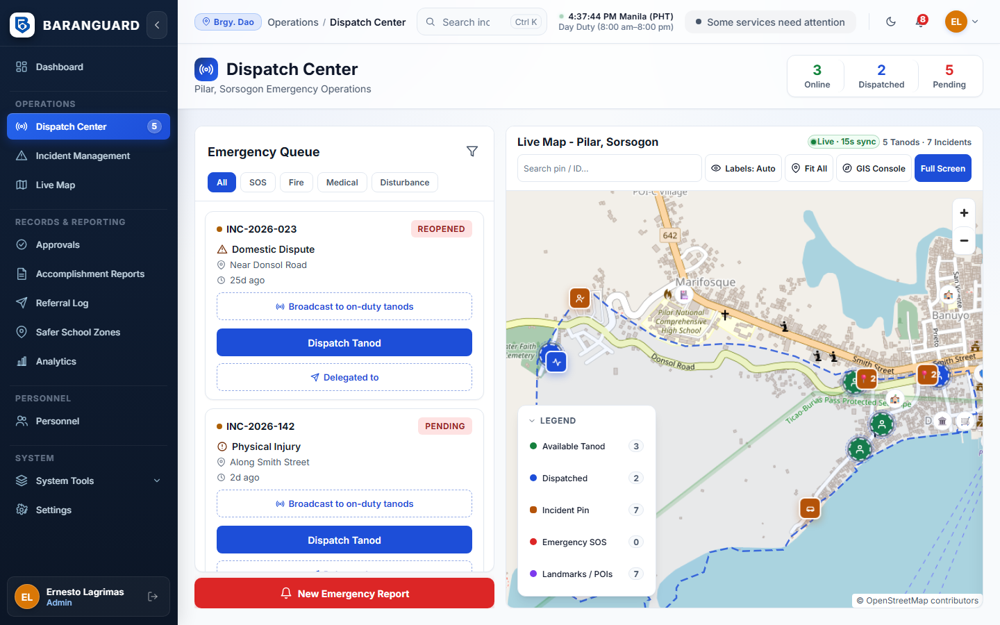
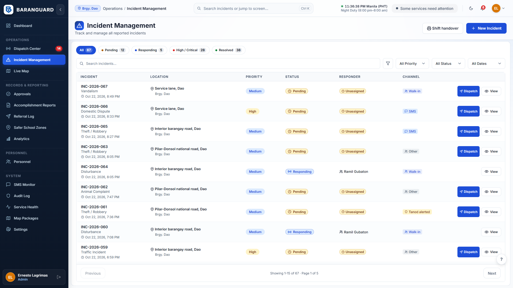
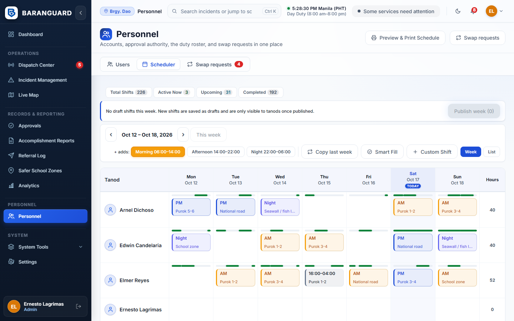

# Baranguard — Chief Tanod Manual

For the Chief Tanod. In the system this is the **Admin** account. You use two things: the web dashboard in the browser on the barangay workstation, and a console on your own phone.

> **Status of this manual.** Written from the code of 2026-10-23 (`web/src/pages`, `mobile/src/pages/admin`, `docs/WORKFLOWS_AND_RULES.md`). The screens were **not checked in a browser or on a phone by the writer**. Button names are copied from the code. If a screen looks different, tell the developer. Items marked **[not verified]** rely on a rule in the docs that the writer could not see in the screen code.

Related: `SECRETARY_MANUAL.md`, `PUNONG_BARANGAY_MANUAL.md`, `ROLE_QUICK_CARDS.md`, `docs/POWER_CUT_PROCEDURE.md`.

---

## 1. What you can and cannot do

You direct and dispatch. You are **not** a responder.

| You can | You cannot |
|---|---|
| Assign, add and cancel responders; broadcast night offers | Be dispatched yourself, receive offers, or enter accomplishment entries |
| Acknowledge and resolve SOS (web and phone) | Mark an incident duplicate, invalid, cancelled or reopened (Secretary only) |
| Resolve incidents (with a reason if no tanod was sent) | Edit the complainant name (Secretary only) |
| Build and publish the weekly roster; approve swaps | Change your own approval rights (another Admin must) |
| Create, suspend and deactivate user accounts | See a narrative on the phone (web only) |
| Read the confidential narrative and party details **on the web** | Do reports, settings or user work on the phone (4 tabs only, section 9) |

The Secretary is your back-up dispatcher. When you are not at the desk the Secretary can do the dispatch and SOS steps in sections 3 to 5 on the web. **[not verified]**

## 2. Signing in

1. Open the dashboard address given by your barangay. Type your username and password. Never share them.
2. Five wrong passwords lock the account for 15 minutes.
3. The web signs you out after **15 minutes with no mouse, keyboard or touch**. A warning shows for the last minute. Move the mouse to stay in. If you sit at the Dispatch Center only to watch for SOS, move the mouse now and then, or rely on the phone console (section 9).
4. Your landing page is the **Dashboard**. Change it under Settings, Appearance.

Sidebar items you see: Dashboard, Dispatch Center, Incident Management, Live Map, Approvals, Accomplishment Reports, Referral Log, Safer School Zones, Analytics, Personnel, SMS Monitor, Audit Log, Service Health, Map Packages, Settings.

## 3. Dispatch Center (web)

Open **Dispatch Center**. Left: the **Emergency Queue**. Right: the live map. Filters: All, SOS, Fire, Medical, Disturbance, and All, Critical, Pending, Dispatched. The queue refreshes every 15 seconds. "Live updates paused" means the page lost contact with the server and is retrying.

### 3.1 Assign a tanod

1. In the queue find the card marked **PENDING** (or **REOPENED**).
2. Press **Dispatch Tanod**.
3. In "Assign incident" pick a name under **On-duty Tanod**. The list shows the distance from the last GPS fix when known.
4. Confirm. The card turns **DISPATCHED** and shows the tanod.

What the system enforces:
- Only tanods who are **on duty**, not already responding, active and in your barangay can be picked.
- The tanod needs a **published shift covering now**. If not, a box "No published shift" asks for an **Override reason (required)**. Write the real reason. It is kept with the dispatch.
- If nobody is on duty the list is empty. Phone or text a tanod and ask them to go on duty. A tanod with no mobile data cannot accept offers, so you assign them directly.

### 3.2 Add another responder

On a dispatched card press **Add Responder**. Same steps. One incident can have several responders.

### 3.3 Cancel a dispatch

1. On the responder's row press **Cancel**.
2. Type the **Reason for cancelling (required)**, 1 to 255 characters.
3. Press **Cancel dispatch**. (**Keep it** backs out.)

You can cancel even after the tanod has arrived. If other responders remain, the incident stays Dispatched. If none remain, it goes back to Pending.

### 3.4 Other buttons on the queue

- **Show Route / Hide Route** draws the tanod's road route. "(may be outdated)" means it could not be refreshed.
- **Delegated to** records that the incident was handed to another office (PNP, BFP, ambulance and so on). It does not change the dispatch or incident status. It adds a Referral Log entry.
- **New Emergency Report** opens Incident Management to log an incident.

## 4. Night dispatch offers

At night (**18:00 up to 06:00 Manila time**) every new pending incident automatically opens an **offer**. It goes to on-duty tanods with no active dispatch and a published shift covering now. If none qualifies it goes to on-duty tanods whose own availability covers now. The alert shows only incident type, barangay and time.

- The **first tanod to tap Accept** becomes the responder. Accept needs a connection and is never queued. The others are released.
- Nobody accepts in **180 seconds**: it is sent again, up to **3 rounds**, and you are alerted. After that it stays **escalated** and reminds you at spaced times. Assign someone yourself (3.1).
- By day, or any time: on a pending card press **Broadcast to on-duty tanods**. If no one qualifies you see "No on-duty tanod could be offered this incident. Assign a responder."
- To withdraw an open offer press **Cancel broadcast**.
- The card shows a line with the offer state and how many tanods were offered, accepted or released.
- You can still add more responders after someone accepts.

## 5. SOS alerts

An SOS alerts every on-duty tanod and every active Admin account. On the web a bar shows at the top of every page and the Dispatch Center has an SOS panel.

For each SOS you see a code, the tanod's name and a location note:
- "Live position from the SOS."
- "Last known position ... not a live fix. Confirm with the tanod."
- "No location available. Call (name) now." The phone had no GPS and no earlier fix.

Steps:
1. **Locate** shows them on the map (not shown when there is no location).
2. **Acknowledge** tells everyone you saw it. **It does not clear the alert.**
3. Contact the tanod. Send help by assigning others if there is an incident.
4. When the tanod is confirmed safe press **Resolve**. It closes for everyone.

If the workstation was unreachable, the tanod's phone texted the backup number instead. Settings, SOS Fallback holds that number.

## 6. Incident Management and resolving

**Incident Management** lists incidents (search; filter by priority, status, date). Select a row to see details. **Open incident record** opens the full page.

### 6.1 Log a new incident

Press **New Incident**. Fill Incident Type, Priority, **Report channel** (tanod-alerted, walk-in, SMS, phone call, Facebook message, other), Location landmark / description, and optionally complainant, person complained about, contact number, school near the incident and the description. Press **Log an Incident**. It joins the queue as Pending.

### 6.2 Resolve

| Situation | Button | What happens |
|---|---|---|
| A tanod was sent and all dispatches are completed or cancelled | **Resolve Incident** (list) or **Mark incident resolved** (record page) | Confirm, then Resolved |
| Nobody was sent (settled by phone, or on the spot) | **Resolve without dispatch** | A reason of 1 to 255 characters is required and kept with the incident |
| A dispatch is still active | Button is greyed | Complete or cancel the dispatch first |

Resolving cannot be undone from this screen. Only the **Secretary** can reopen an incident.

### 6.3 What you can read

The record page shows complainant, respondent, contact numbers and the official narrative (web only, so you can brief a responding tanod). Each read is logged by incident number. Do not copy a narrative into SMS or chat.

The page says narratives are removed after 90 days. The policy since 2026-10-17 is one year. **The screen text is out of date.**

## 7. Personnel: Scheduler (week grid)

Open **Personnel**. You have three tabs: **Users**, **Scheduler**, **Swap requests**.

### 7.1 How a roster works
1. Tanods may state when they are free (Availability, on their phones). It is optional. A tanod who gave windows can only be scheduled inside them.
2. You or the Secretary place shifts in the week grid. They are saved as **Draft**. Tanods cannot see them.
3. You **print** the roster. The officials **sign the paper**. The app does not record the signature.
4. You **publish**. Tanods get a notification and see their shifts.

### 7.2 Steps in the week grid
1. Choose the week with the arrows. **This week** jumps back.
2. Under **+ adds:** pick what the **+** button adds: Morning 06:00-14:00, Afternoon 14:00-22:00, Night 22:00-06:00.
3. Press **+** in a tanod's day cell. A draft shift appears.
4. Drag a shift to move it (you confirm "Move"). Click a shift to edit tanod, time or patrol zone.
5. Also: **Copy last week**, **Smart Fill** (fills open slots with available, lower-hours tanods), **Custom Shift** (any time, in a dialog).
6. **Print preview** gives an A4 roster for signing.
7. When it is signed press **Publish week (n)** and confirm.
8. If a day has nobody scheduled you see "Published with coverage warnings". The week still publishes.

Limits: **12 hours per tanod per day** (DAILY_HOURS_EXCEEDED). A tanod with availability windows cannot be scheduled outside them (OUTSIDE_AVAILABILITY). The grid shows a weekly Hours total per tanod for information.

Changing the tanod, start or end of a **published** shift turns it back to **Draft**: print, sign and publish again. Changing only the patrol zone does not.

A **List** toggle gives a table with Set Zone, Reassign, Unassign and Publish for ticked shifts.

### 7.3 Swap requests
A tanod may ask to swap a published shift. Open **Swap requests**. Press **Approve** or **Deny**. A badge shows how many wait. An approved swap keeps the shift published with the new tanod, who must pass the same checks.

## 8. Personnel: Users

1. **Personnel**, **Users**. Search or filter by role and status.
2. **Add User**: Full Name, Username (letters, numbers, . _ -), Initial Password (at least 12 characters, mixed case, a digit), Role (Admin, Secretary, Tanod, Punong Barangay), Contact Number. **Create Account**. Give the password to the person privately. They should change it in Settings, Password.
3. Per row: **Suspend** (signs them out at once), **Unsuspend**, **Deactivate** (closed), **Reactivate**. You cannot act on your own row.

**Approval rights.** No screen sets them. You and the Secretary hold every sign-off right by role. The Punong Barangay holds none by default. Signatures happen on paper.

## 9. Your phone: Chief Tanod console

Sign in on the Baranguard app with your Admin username and password. A session lasts 24 hours of use and at most 7 days. **Everything needs a connection and nothing is queued**, except a logged incident (9.4). There are **4 tabs**: SOS, Dispatch, Incidents, Profile.

> **[Not device verified.]**

### 9.1 SOS tab
- Active alerts first, then Acknowledged. Older ones sit under **Earlier alerts**.
- On an Active card press **Acknowledge**. On an Acknowledged card press **Mark resolved** and confirm. Close it only when the tanod is confirmed safe. It closes for everyone, including the dashboard.
- The **SMS fallback number** card shows where tanods' phones text if they cannot reach the workstation.

### 9.2 Dispatch tab
- **Active dispatches**: tanod, status, incident. Buttons **Open incident** and **Cancel dispatch** (reason required).
- **Dispatch offers**: state of each offer, **Cancel offer** while live, **Show finished offers**.
- Pull down to refresh.

### 9.3 Incidents tab and the incident sheet
Search by code, type or location. Filter All, Pending, Dispatched, Resolved, Other. Tap an incident to open its sheet: type, priority, channel, location, responders. **Narratives are never shown on the phone.**

In the sheet:
- **Assign more responders**: pick a tanod, **Assign**. With no published shift, a box "No published shift" asks for a reason, then **Assign with override**. The phone does not show shift availability. Check the roster on the dashboard if unsure.
- **Take over (offer to on-duty Tanods)** starts a broadcast offer.
- **Cancel dispatch** beside an active responder (reason required).

Resolving an incident is web only.

### 9.4 Log an incident from the phone
Incidents tab, **Log an incident**. Choose type, priority, **How it was reported** (phone call, Facebook message, walk-in, SMS, other), place, optional caller and what was reported. **Save incident**. With no signal it is saved on the phone ("will be sent when the connection returns") and sent while the app is open. A banner counts reports not yet sent.

### 9.5 Profile tab
Shows your name, "Workstation: Reachable / Not reachable", the device, a privacy notice and **Sign out**. After signing out you stop receiving SOS and escalation alerts on this phone.

## 10. Other web pages

- **Live Map**: tanod positions, SOS, incidents. A stale position is marked stale.
- **Approvals**: what is waiting: shifts to publish, accomplishment reports to print and sign, Annex D to prepare. Each row opens the right page.
- **Accomplishment Reports**: **Preview & print** (A4) a submitted report, or **Return to tanod** with a reason. See Secretary manual section 7.
- **Referral Log**, **Safer School Zones**: see the Secretary manual.
- **Analytics**: tabs Reports and Heatmap. Reports can be printed, exported to CSV or downloaded as PDF. They say "system-generated, not signed". Heatmap shows past patterns only.
- **SMS Monitor**: activity log, conversations, broadcast and direct message. Broadcasts reach your own barangay only.
- **Audit Log**: permanent record of actions. It cannot be edited.
- **Service Health**: whether database, routing, SMS gateway, push and tunnel work. Grey "configured" means set up but not tested.
- **Map Packages**: offline maps. Publishing sends the map to all tanod phones.
- **Settings**: Profile, Password, Appearance. You also get General and SOS Fallback.

## 11. When something goes wrong

| What you see | Do this |
|---|---|
| "Live updates paused" | Check the workstation network. The page keeps retrying |
| Signed out suddenly | 15 minutes without input. Sign in again |
| Account locked | Wait 15 minutes |
| No tanod to assign | Phone a tanod to go on duty, or assign with an override reason |
| Power or internet down | Follow `docs/POWER_CUT_PROCEDURE.md`. Keep a paper logbook and enter it afterwards |

## 12. Known gaps and doubts

- The record page says narratives are removed after 90 days; policy is one year.
- Settings shows an old role blurb for the Secretary (blotter, citizen triage).
- Two tanods accepting one offer at the same instant, and the 12-hour cap under heavy use, were reasoned in code, not tested.
- Phone console and offline off-duty: not device verified.
- On the incident record page only the Admin sees Dispatch and Resolve buttons. The Secretary uses Incident Management for those.
