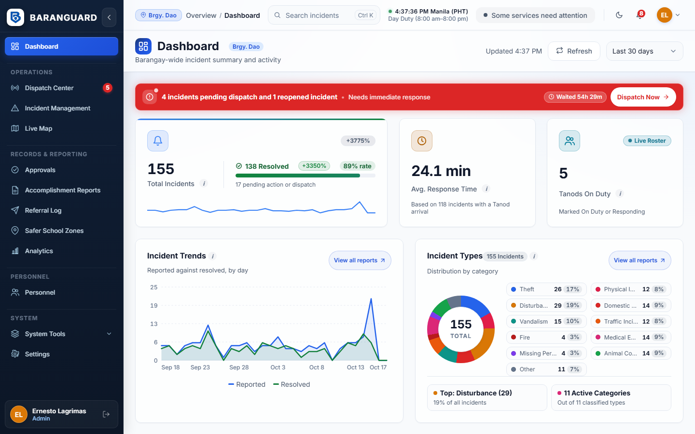
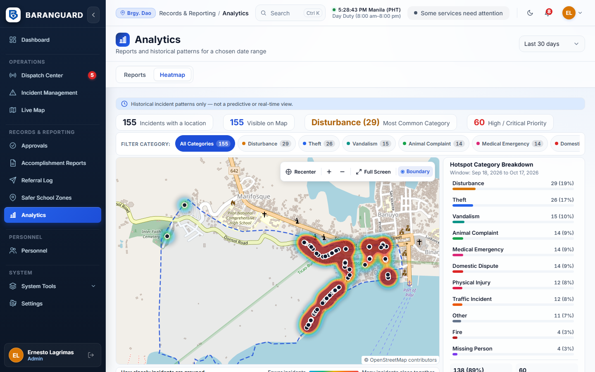
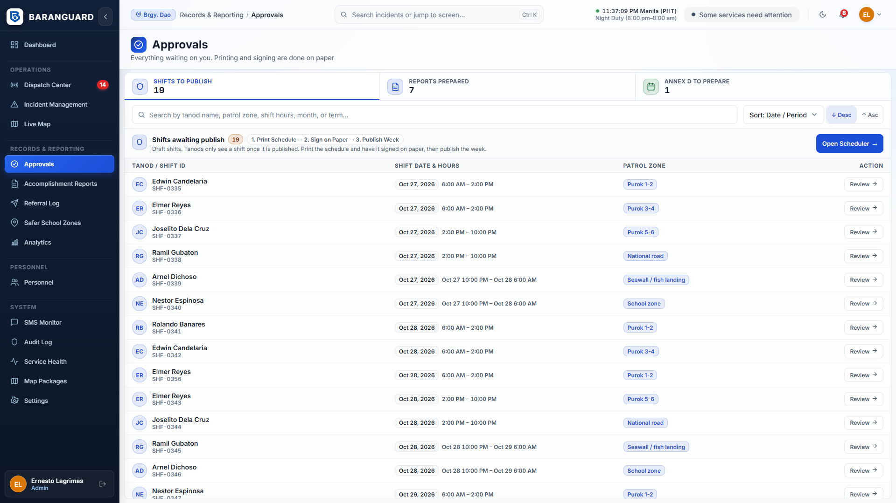
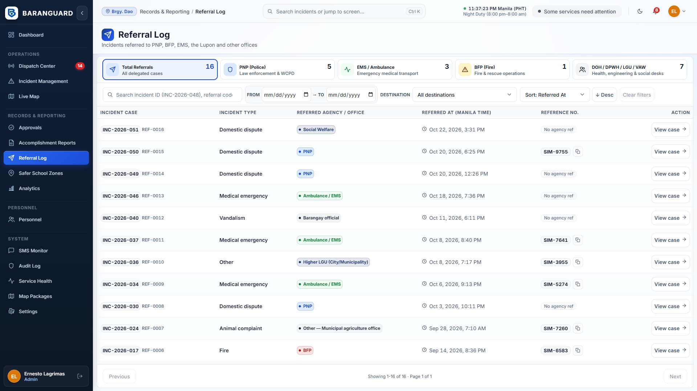

# Baranguard — Punong Barangay Manual

Purpose: user guide for the Punong Barangay (oversight) on the web dashboard.
Status/Last updated: 2026-10-28. Written from code of 2026-10-23; not checked in a browser.

For the Punong Barangay. You use the web dashboard in the browser. Your role is **oversight**: you watch, you read reports, you sign on paper. You do not dispatch.

> **Status of this manual.** Written from the code of 2026-10-23 (`web/src/pages`, `docs/WORKFLOWS_AND_RULES.md`, `docs/REFERENCE.md`). The screens were **not checked in a browser by the writer**. Button names are copied from the code. If a screen looks different, tell the developer. Items marked **[not verified]** could not be confirmed in the screen code.

Related: `CHIEF_TANOD_MANUAL.md`, `SECRETARY_MANUAL.md`, `ROLE_QUICK_CARDS.md`.

---

## 1. What you can and cannot do

| You can see | You cannot |
|---|---|
| Dashboard, Live Map, Analytics (reports and heatmap) | Dispatch, cancel, resolve or edit an incident |
| One incident at a time (from the dashboard): the operational summary | Read the confidential narrative, the complainant or respondent, or evidence files |
| Referral Log, Safer School Zones (read), Accomplishment Reports | Browse a list of all cases (the case ledger is DILG BIMS/KPIS) |
| Scheduler tab (the roster, read only) | Create users, see the Users tab, SMS Monitor, Audit Log, Service Health, Map Packages |
| Your own Settings | See tanod names on the dashboard roster (you see the count) or call tanods from the map |

Why: the narrative and party details belong to the Secretary as records custodian (RA 7160 Sec. 394). The Chief Tanod may read them on the web to brief responders. Baranguard complements DILG BIMS and never replaces it.

You sign printed reports, rosters and Annex D **on paper**. The app does not record signatures.

## 2. Signing in

1. Open the dashboard address. Type your username and password. Never share them.
2. Five wrong passwords lock the account for 15 minutes.
3. The page signs you out after **15 minutes with no input**, with a warning during the last minute.
4. You land on the **Dashboard**. Change the landing page under Settings, Appearance.

Sidebar: Dashboard, Live Map, Approvals, Accomplishment Reports, Referral Log, Safer School Zones, Analytics, Personnel, Settings.

## 3. Dashboard

- **Attention banner** at the top when there are open Tanod SOS alerts, incidents waiting for dispatch, or reopened incidents. For you it says "The Chief Tanod (Admin) handles dispatch. You can follow it on the Live Map." The button **View Live Map** opens the map. A "Waiting 12m" or "Waited" chip shows how long the oldest urgent item has waited.
- **Date range** picker. The cards and the recent list follow it.
- **Total Incidents**, **Avg. Response Time**, **Tanods On Duty**. Response time is "incident reported to first Tanod arrival" and is never a ranking of tanods. If no incident was reported in the range, a note says so.
- **Recent incidents**: the open ones plus those of the last 30 days. Click one to open its page. If there are none: "No open incidents and none reported in the last 30 days."
- **Tanods On Duty**: the count. The named roster is for the Admin.
- **Pending approvals**: see section 7.
- **Weekly Digest card**: shows the period, when it was made and "System-generated, not signed. Sign on paper after review." Press **Download Weekly Digest PDF**. Before the first run it says "No digest has been generated yet."
- **Refresh** reloads the page data.

## 4. One incident page

Click an incident on the dashboard. You see type, status, priority, time, location, channel, the responders, timeline and school link. Where a field is confidential you see "Restricted to the Barangay Secretary and the Chief Tanod". Evidence says "Not available for your role."

**Print Case Record** prints the page. You have no Dispatch, Resolve or lifecycle buttons.

Search (top bar) matches an exact incident number only, for example `INC-2026-048`. It does not search names or text.

## 5. Live Map

Open **Live Map**. It shows tanod positions, incidents and SOS markers for your barangay only, refreshed about every 15 seconds. Filters: All, Available, Dispatched, Stale.

- A tanod position older than about 2 minutes is marked **stale**. Never treat a stale position as live.
- SOS markers stay on top of other filters.
- There is no **Call** button for you. Tell the Chief Tanod instead.

## 6. Analytics

Open **Analytics**. Two tabs.

**Reports**
1. Pick the date range.
2. Read the cards: Total Incidents, Avg. Response Time, Active Tanods; busiest day, most common type, peak hour; tables by type and by status.
3. **Print preview** gives an A4 statistical report. **Export CSV** and **Download PDF** save files.
4. The report is labelled **system-generated and unsigned**. Review it, then sign the blank "Reviewed and approved by" block on paper. Nothing is pre-filled.

**Heatmap**
Shows where incidents happened, with category filter and a hotspot breakdown. It says "Historical incident patterns only — not a predictive or real-time view." Use it to plan patrols, not to blame a place.

## 7. Approvals and signing on paper

**Approvals** lists what is waiting: shifts to publish, accomplishment reports ready to print and sign, Annex D to prepare. Approval rights are not a setting you can change, and by default the Punong Barangay holds none, so **you will usually see "Nothing waiting for you"**. The page text then says an Admin can assign one under Personnel, Users. That text is out of date; there is no such screen. **[A PB account whose database record still carries an old value from the early backfill may see queues. Ask the developer to check your account if you expect them.]**

The real approval is your **signature on the printed paper**:

1. The Chief Tanod or Secretary prints the roster, accomplishment reports or Annex D on A4.
2. You review the paper and sign.
3. They publish or file it. The app shows who prepared a document and the audit log shows who acted.

If you disagree, tell the Chief Tanod or Secretary. A prepared accomplishment report can be returned to the tanod by them with a reason.

## 8. Read-only pages

### Accomplishment Reports
Monthly reports from each tanod: month, status (Open, Prepared, Returned), number of entries, total time, flagged entries. Open one to see the summary. **Preview & print** appears for prepared reports. Entries marked "check" are where the tanod's confirmed time differs from the system's duty record by more than 30 minutes. Whether you can read the entry text depends on your account; Admin and Secretary always can.

### Referral Log
Which incidents were handed to which office (PNP, BFP, EMS, Lupon/KP, and others), when, and the reference. It has no names and no narrative. It is a log of handovers, not a case list.

### Safer School Zones
Tabs Schools (Annex B), Incidents (Annex C-1) and Term Report (Annex D). You can read and print. Editing is for the Secretary and Chief Tanod. Printouts are marked as a draft layout until the barangay checks them against DILG MC 2026-037. Annex D carries a blank block for your signature as "Punong Barangay / BPOC Chairperson".

### Personnel: Scheduler
Only the **Scheduler** tab opens for you. You see the week roster and draft or published badges. You cannot create or change shifts. You may be asked to sign the printed roster.

## 9. Settings

Profile, Password (at least 12 characters, mixed case, a digit) and Appearance (light or dark, landing page).

## 10. What to do when

| Situation | Do this |
|---|---|
| You see an SOS banner, or you are texted an SOS | Tell the Chief Tanod at once. You cannot acknowledge or dispatch. You are texted only when nobody has acknowledged the SOS after two repeats |
| A report needs to be changed | Ask the Secretary |
| Power or internet is down | No power-cut procedure is documented. The system serves one workstation and stops when it stops |
| You think someone read a record they should not | Tell the Chief Tanod. The audit log records each narrative read by incident number |

## 11. Known gaps and doubts

- The Approvals empty text refers to an Admin setting that no longer exists.
- Settings shows an old role blurb (incident approvals).
- Whether a Punong Barangay account carries any stored approval value depends on the database and was not checked.
- Dashboard, map and analytics were checked in jsdom tests and code only, not in a browser by the writer.
- Annex layouts and the circular's deadlines are drafts, not confirmed.
