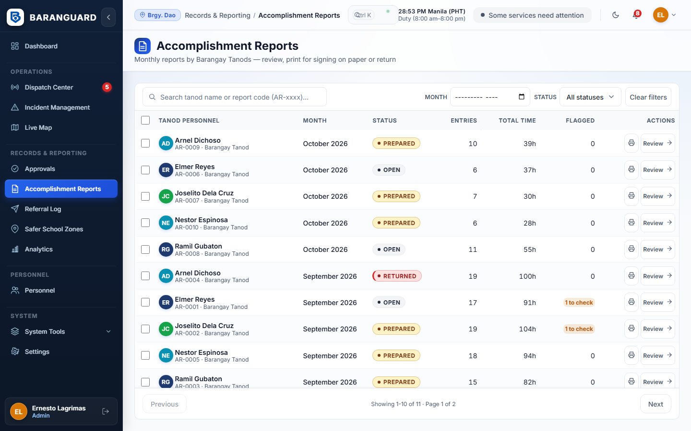
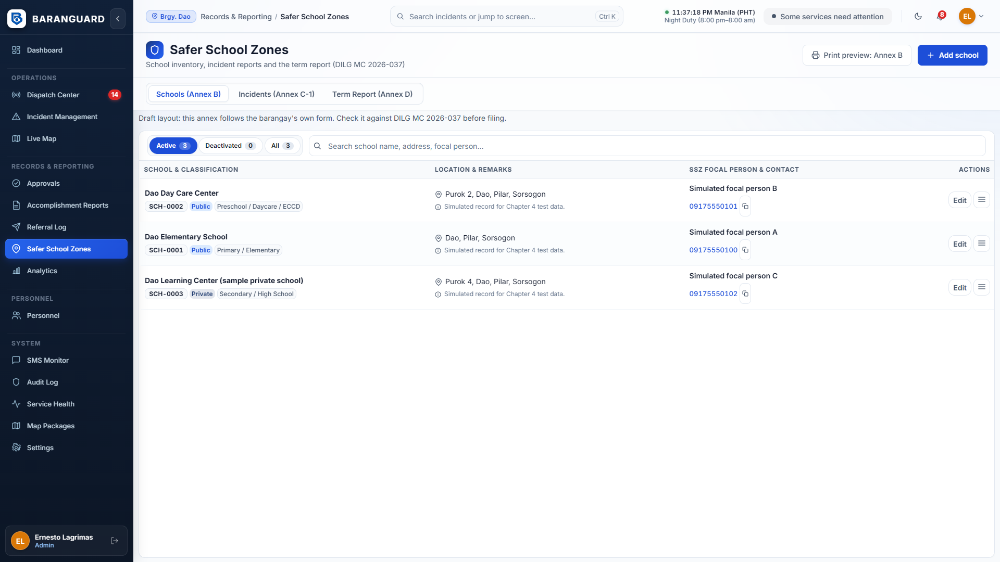

# Baranguard — Secretary Manual

For the Barangay Secretary (Records and Reports Officer). You use the web dashboard in the browser. You have no phone console.

> **Status of this manual.** Written from the code of 2026-10-23 (`web/src/pages`, `docs/WORKFLOWS_AND_RULES.md`, `docs/REFERENCE.md`). The screens were **not checked in a browser by the writer**. Button names are copied from the code. If a screen looks different, tell the developer. Items marked **[not verified]** rely on a rule in the docs that the writer could not see in the screen code.

Related: `CHIEF_TANOD_MANUAL.md`, `PUNONG_BARANGAY_MANUAL.md`, `ROLE_QUICK_CARDS.md`.

---

## 1. Your role in one paragraph

You are the records custodian. You read the confidential narrative, you are the only one who can mark an incident duplicate, invalid, cancelled or reopened, and you are the only one who can edit the complainant name. You keep the school list (Annex B), the school incident notes (C-1) and prepare the term report (Annex D). You print the accomplishment reports and rosters that officials sign on paper. When the Chief Tanod is away you are the **back-up dispatcher**.

Baranguard does **not** replace DILG's BIMS/KPIS. The case record and blotter stay in your binders and in BIMS. Baranguard only records the operational side.

## 2. Signing in

1. Open the dashboard address. Type your username and password.
2. Five wrong passwords lock the account for 15 minutes.
3. The page signs you out after **15 minutes with no input**. A warning shows for the last minute. Unsent text in an open form is lost.
4. You land on **Incident Management**.

Sidebar: Incident Management, Dispatch Center, Approvals, Accomplishment Reports, Referral Log, Safer School Zones, Personnel, Settings. You do **not** see Dashboard, Live Map, Analytics, SMS Monitor, Audit Log, Service Health or Map Packages.

## 3. Incident Management: log and find incidents

- Search at the top. Filter by priority, status and date (All Dates, Current Shift, Today, Past 24 Hours).
- Select a row to see details on the right. **Open incident record** opens the full record page.
- **Shift handover** prints a handover summary (A4) or exports CSV.

### Log a walk-in, phone or Facebook report

1. Press **New Incident**.
2. Fill **Incident Type**, **Priority**, **Report channel** (tanod-alerted, walk-in, SMS, phone call, Facebook message, other), **Location Landmark / Description**.
3. Optional: **Complainant / Reporter Name**, **Person complained about**, **Complainant contact number**, **School near the incident**.
4. Write the description in **Incident Description / Narrative**.
5. Press **Log an Incident**. It joins the dispatch queue as Pending.

There is no public form and no citizen inbox. Every report is logged by staff with its channel.

### Correct an incident

Select the incident and press **Edit**. You may change type, priority, location and the complainant name. **The narrative cannot be edited here.**

## 4. The incident record page

Open it from Incident Management. You see: particulars, **Involved Parties**, **Official Incident Narrative**, evidence, responders, timeline and **Case Connections and References**. **Print Case Record** prints it.

### Who may read the narrative

| Role | Narrative and party contacts |
|---|---|
| You (Secretary) | Yes, on the web |
| Chief Tanod (Admin) | Yes, on the web only, so he can brief a responder. He cannot edit them. Not on his phone |
| Punong Barangay | No. Sees a notice "Restricted to the Barangay Secretary and the Chief Tanod" |
| Tanod | Only their own assignments in the app |
| Another barangay | The incident does not exist for them |

Rules for you:
- The narrative never goes out by SMS, push, chat or logs. Do not paste it into SMS or Messenger.
- Every read is recorded in the audit log by incident number only.
- Narratives are deleted after **one year**. The page still says "90-day". That text is out of date; the policy changed on 2026-10-17.
- If the narrative is blank, the page says "No narrative recorded" (recent) or "removed after the retention period" (old).

## 5. Incident lifecycle (only you)

On the record page open **Case lifecycle**. You see only the buttons that are legal from the incident's current status.

| From | You may choose |
|---|---|
| Pending, Dispatched, Reopened | **Mark as duplicate**, **Mark invalid**, **Cancel this incident** |
| Resolved, Cancelled, Invalid, Duplicate | **Reopen this case** (only) |

Steps for a duplicate:
1. Press **Mark as duplicate**.
2. Type the number of the original, for example `INC-2026-048` (same barangay only). Press **Look up incident**.
3. Check the incident shown. Confirm.

Nothing is deleted or merged. Both records stay. The record shows "Linked as a duplicate of another incident."

Rules:
- If a tanod is still dispatched, you cannot mark duplicate, invalid or cancelled. The note says "A dispatch is still active. Complete or cancel it before changing the lifecycle." **Reopen** is allowed anytime.
- A closed incident goes only to **Reopen**. It cannot jump to another closed state.
- A reopened incident returns to the Chief Tanod's dispatch queue with a **REOPENED** badge.
- To say two incidents are related without changing any status (even while a dispatch is open) use **Related incident** in the same section: type the other incident number and save.

You do **not** resolve through this card. See section 9 for resolving as back-up dispatcher.

## 6. Referrals

When an incident is handed to another office:
1. On the record page, in **Referrals** (or **Delegated to** on a Dispatch Center card), press the add button.
2. Choose **Delegated / referred to**: PNP, BFP, ambulance/EMS, barangay official, VAW desk, social welfare, higher LGU, DOH, DPWH, **Lupon / Katarungang Pambarangay**, or other. For Other, write who.
3. Optional: **Unit or official** (a unit or official, never a citizen's name), **When** (blank means now), **Reference number**.
4. Press **Record referral**.

It records a handover only. It does not mean the office accepted or arrived, and it does not change the dispatch or incident status. For a Lupon referral keep the case itself in your binder and BIMS.

**Referral Log** (sidebar) lists all referrals: incident, type, agency, time, reference. It has no names and no narrative. Use the filter strip and search; the reference number can be copied.

## 7. Accomplishment reports: print on A4

Each tanod's monthly report is their attendance record for honoraria. The tanod submits it on the phone (online). It is printed and signed on paper. **The app does not record who signed.** Whether the treasurer and COA accept this is for the barangay to confirm.

Statuses: **open** (tanod still writing), **prepared** (submitted and locked, ready to print), **returned** (sent back).

### Steps
1. Open **Accomplishment Reports**. Filter by month or status. Search by name or report code.
2. A prepared report shows in the list. Press **Review** to open it. You can read the entry text and see **Entries to check**: entries where the tanod's confirmed time differs from the system's duty record by more than 30 minutes.
3. Press **Preview & print**. A preview opens. Print on **A4**. The printout says system-generated and carries the barangay letterhead. If the letterhead could not be loaded, the preview warns you: do not file that copy.
4. For many reports tick the boxes and press **Batch Preview & print (n)**.
5. Take the paper to the officials for signature. Keep the signed paper.
6. If the report is wrong press **Return to tanod**, type the reason (shown to the tanod, 1 to 255 characters) and confirm. The tanod edits and resubmits. The tanod gets a phone notice with the month and the outcome.

The **Approvals** page also lists "Accomplishment reports prepared" and opens the same screen.

## 8. Safer School Zones (Annex B, C-1, D)

Open **Safer School Zones**. Every printout says it is a **draft layout** built from the barangay's forms. The circular's deadlines are not known to the system, so none is shown. Check the layouts against DILG MC 2026-037 before filing.

### 8.1 Schools tab (Annex B)
1. Press **Add school**.
2. Fill **Name of school**, **Public or private**, **Level**, **Complete address**, **SSZ focal person**, **Focal contact number**, **Remarks (include possible hotspots)**. The first four are required.
3. Save. Use the row actions to edit, deactivate (schools are never deleted) or **View on Live Map**.
4. The print button at the top prints Annex B for active schools. If none is active, a message says so.

No student names, ever.

### 8.2 Incidents tab (Annex C-1)
- Lists incidents linked to a school. Filter by agency (barangay only, PNP, EMS, BFP, other). Sort by date, school or escalation. **View case** opens the record. Print gives Annex C-1.
- To link an incident to a school and write the C-1 text, open the incident record, **School link and Annex C-1** card. Fields: **School**, **Summary (Annex C-1)** (short and factual), **Action taken**, **Status notes**. Save. Never write a student's name or anything that identifies a child. This text is separate from the confidential narrative.

### 8.3 Term Report tab (Annex D)
1. Choose the term start and end dates (or a quick preset). Live counts appear.
2. Enter the **Term Label**. Press **Create draft term report**.
3. Open the draft. Add **Remarks** and **Other institutions referred to** (separate with semicolons). Save the draft.
4. Press **Mark as prepared**. The counts are recomputed from live data at this moment.
5. Print the prepared report (A4). The signature blocks are Chief Tanod / Executive Officer and Punong Barangay / BPOC Chairperson. Have it signed on paper.
6. When the Office of the Mayor has received it, enter **Received by (Office of the Mayor)** and **Date received**, and optionally the DILG copy fields. Press **Mark as submitted** and confirm. **This cannot be undone.**

A draft is stamped "DRAFT - NOT FOR SUBMISSION" until it is submitted.

## 9. Back-up dispatcher duties

When the Chief Tanod is away you can do these on the web:

- **Assign** a tanod: Dispatch Center or Incident Management, **Dispatch Tanod** (or **Assign**), choose the tanod, confirm. Without a published shift you must write an override reason. See Chief Tanod manual section 3.
- **Add responder**, **Cancel** a dispatch (reason required).
- **Broadcast to on-duty tanods** and **Cancel broadcast** (night offers).
- **Resolve** an incident: in Incident Management press **Resolve Incident** (a tanod was sent and all dispatches ended) or **Resolve without dispatch** (reason required). **On the incident record page the Dispatch and Resolve buttons appear for the Admin only. Use Incident Management.**
- **SOS**: Acknowledge and Resolve in the Dispatch Center SOS panel. **[not verified]**

Things that stay different from the Chief Tanod:
- You see the tanod list without contact numbers.
- Offer alerts (sounds and pushes) are sent to Admin accounts only. SOS alerts go to Admin accounts first; if nobody acknowledges, the alert is repeated every 2 minutes and, from the third send, you are texted too (Rule 99). If you cover the desk, keep the Dispatch Center open and the sound on.
- You have no phone console.

## 10. Personnel for the Secretary

Tabs: **Scheduler** and **Swap requests** (not Users).
- **Scheduler**: you can create and edit draft shifts, print, and **Publish week**. The steps are in the Chief Tanod manual, section 7.
- **Swap requests**: **Approve** or **Deny**.

## 11. Approvals page

A list of what is waiting for printing or publishing: shifts to publish, accomplishment reports prepared, Annex D to prepare. Click a row to go to the right screen. Signing is never done in the app.

## 12. Settings

Profile, Password (at least 12 characters, mixed case and a digit) and Appearance (light or dark, landing page).

## 13. Known gaps and doubts

- Narrative retention text on the record page says 90 days; policy is one year.
- Settings shows an old blurb for your role (blotter, citizen triage).
- The Annex B, C-1 and D layouts are drafts. Deadlines and filing frequency are unknown.
- Retention for referrals, accomplishment reports, check-ins and submitted Annex D is a provisional one year, to be confirmed by the barangay and COA.
- Whether Secretary SOS acknowledge and resolve works in the screen: not verified.
