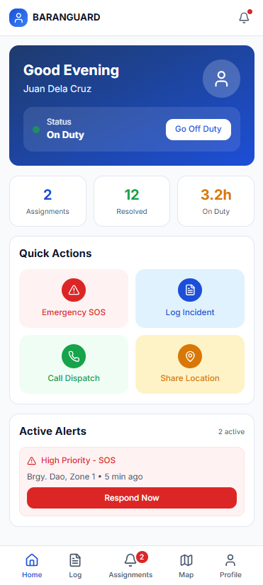
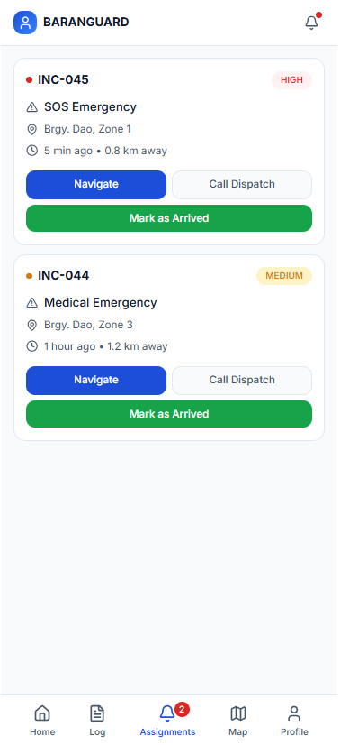

# Baranguard Tanod Manual (Mobile App)

For tanods using the Baranguard app on their Android phone. Short steps, simple words.

**Status:** Written from the app screens in the code. Parts not yet tested on a phone are marked "(not yet device-verified)". Some screens may look a little different on your phone.

---

## 1. What the app is for

- Tell the barangay desk when you are **on duty** and **off duty**.
- Send an **SOS** when you are in danger.
- Receive and answer **dispatch calls** (calls to go to an incident).
- **Report incidents** you see, even with no signal.
- Record your **availability**, your **accomplishments**, and your **school check-ins**.
- See your **published shifts**.

The app keeps your records **on your phone first**. If there is no signal, they are sent later by themselves.

## 2. The bottom buttons

| Button | What it opens |
|---|---|
| **Home** | Duty button, SOS, emergency phone numbers |
| **Dispatches** | Calls given to you |
| **Report** (big + button) | New incident report |
| **Map** | Live map |
| **Profile** | Shifts, availability, accomplishments, school check-in, sync, sign out |

*(Sample picture of the Home screen.)*

## 3. Signing in

1. Open the **Baranguard** app.
2. Type your **Username** and **Password**. Tap the eye icon to see what you typed.
3. Tap **Sign In to Console**.

Notes:
- You need internet (mobile data or Wi-Fi) to sign in.
- "Unable to sign in with those credentials": check your username and password. After **5 wrong tries** the account is locked for **15 minutes**. Wait, then try again.
- "Cannot reach the Baranguard server": check your signal.
- Your username and password come from the Chief Tanod. Never share them.
- A phone is tied to one account. If another account used the phone before, the app says "This phone is registered to a different account." Ask the Chief Tanod to reset the phone.

To sign out: **Profile**, then **Sign out**, then **Sign Out**.

## 4. Going on duty and off duty

Do this on the **Home** screen. The top card shows your name and your duty status.

**Go on duty**
1. Tap **Go on duty**. This needs a connection to the barangay workstation.
2. The card shows **GPS: sharing live**. Now the desk can see your location.

**Go off duty**
1. Tap **End shift**.
2. Tap **End Shift** again to confirm (or **Stay On Duty** to cancel).

Notes:
- You cannot go off duty while you still have an **active dispatch**. Finish it first.
- With no signal, going off duty is **saved on the phone** with the time you tapped, and sent later. The app says "waiting to sync with HQ".
- Keep location (GPS) allowed for the app, or the desk cannot see you.

## 5. SOS (emergency)

Use only when you or someone near you is in real danger.

1. On **Home**, tap the red **EMERGENCY SOS** button.
2. The app asks: "Send SOS to HQ and nearby tanods?"
3. Tap **Confirm: send SOS**. (Tap **Cancel** if it was a mistake.)
4. Read the result:
   - **SOS sent**: the barangay desk received it.
   - **SOS saved on this phone, will send when online**: there was no connection. It is kept and sent as soon as you are online.
5. Tap **Done**.

**What is sent:** your location. If the phone has no GPS fix, the SOS is still sent (the desk sees your last known place, or "no location").

**If there is no internet (SMS fallback)**

The phone also tries to send **text messages by itself**:
- a coded text to the command-center gateway phone, and
- a plain text to the **backup contact number**, with your name, barangay and location.

A message on screen tells you what happened. A small label may show on Home:

| Label | Meaning |
|---|---|
| **Sent by SMS** | The text left your phone |
| **SMS pending** | Still sending |
| **SMS failed** | The text did not leave. Call the desk directly |
| **Saved locally for retry** | Kept on the phone, will send when online |

If a red notice says SOS alerts "could not be delivered to HQ", tap **Retry** and **call the barangay desk directly**.

Important:
- Texting needs **SMS permission** and a working SIM with **load**. (not yet device-verified)
- The SMS fallback needs a gateway number and a backup contact set by the Chief Tanod. If none is set, the SOS is only saved on the phone.
- On **Home** there are call buttons: **Backup contact**, **Police 911**, **MDRRMO 160**.

## 6. Dispatches (calls given to you)

When the Chief Tanod dispatches you, your phone makes an alert. Open **Dispatches**.

*(Sample picture of the Dispatches screen.)*

### Night calls (open offers)
At night a call may be offered to several tanods. The card says "Open call. First to accept gets it."
1. Tap **Accept call**. This needs a connection.
2. If someone else was first, the app tells you. The call is not yours.

### Working a dispatch
1. Tap the dispatch to open it. The **Briefing** shows what to know and where.
2. A dispatch has 4 stages: **Assigned**, **En Route**, **Arrived at Scene**, **Completed**.
3. Tap the big button for the next stage:
   - **Go En Route** when you start moving
   - **Mark Arrived at Scene** when you get there
   - **Mark Completed** when finished, then **Confirm & Complete**
4. With no signal, the change is **saved on the phone** and sent later. The app says "queued".

### Route and directions
- **Go En Route** opens the map and route.
- A live route needs a connection. Offline, the app says it cannot fetch a live route, or shows the last route, which may be out of date. Use your own judgment.
- **Re-route** asks for a new route. **Google Maps** opens directions in Google Maps (needs internet).

### Photos and voice notes (evidence)
In the dispatch, open the evidence section.
1. Tap **Add Photo** or **Record Audio** (**Stop & Save** to finish).
2. If the camera or microphone is blocked, open the phone **Settings** for this app and allow it.
3. Files bigger than 25 MB are not accepted.
4. Each file shows **Saved on this phone** until sent. Tap **Send now** or **Retry upload** if needed.

(Evidence on assigned incidents: not yet device-verified.)

### Referral (handing the case to another office)
Large cases are **referred**, not handled by you.
1. Open the dispatch, open **Referral**, tap **Refer This Case**.
2. Choose **Referred to**: PNP, BFP, Ambulance / EMS, Barangay official, VAW Desk, Lupon / Katarungang Pambarangay, Social welfare, Higher LGU, DOH, DPWH, or Other.
3. If you choose **Other**, type the agency or person. The other boxes (office, receiving unit, reference number) are optional.
4. Do **not** write the name of any complainant, victim or citizen.
5. Tap **Record referral**.

This only records that **you handed the case over**. It does not change the dispatch and does not prove the agency accepted it. It works offline and is sent later. You can also refer from the confirmation screen after sending a new report.

## 7. Report a new incident (works offline)

1. Tap the big **+ Report** button (or **Report incident** on Home).
2. Choose the **Incident Type** (Disturbance, Theft, Injury, Traffic, Medical, Fire, Domestic, Vandalism, Missing, Animal, Other).
3. Write **What Happened** (required): people involved, exact place, what you did. You can tap a quick phrase to start.
4. Add the **location**: **Use Current GPS** or **Choose on Map**. You can also save without a map pin.
5. Optional: open **More details** for the school link, C-1 notes, photos or audio.
6. Tap **Submit report**.

What happens next:
- The report is **saved on the phone first**. The next screen tells you the real state:
  - **Report Saved Offline**: no signal yet, will send.
  - **Waiting to Sync**, **Sync Queued** or **Sync Pending**: on its way.
  - **Report Submitted & Synced** or **Report Synced**: the desk has it.
- If you leave before submitting, the app keeps a **draft**. You will see "Draft restored". Tap **Discard draft** to remove it.
- Your reports are listed in **Profile**, then **My filed reports**.

In school notes, keep it **short and factual**. Do **not** write names of students.

## 8. Waiting-to-send records (sync)

- A small badge at the top shows **CACHE** when offline, or "N waiting" when records are waiting. Tap it to open the **Sync queue**.
- In **Profile**, **Sync and storage** shows ONLINE or OFFLINE MODE. Tap **Sync records now** to try sending.
- A red "needs attention" item was refused by the desk. **Discard** only if you are sure. It cannot be undone.
- "Session expired": sign in again. Saved items stay on the phone and send after you sign in.

## 9. My availability

Tell the desk the days and hours you can serve. It is optional, but if you submit it, the roster follows it.

1. **Profile**, then **My availability**, then **New availability**.
2. Choose the period (a few days to a few weeks; the app shows the limit).
3. Tap a day to mark it **Available**, then set the hours. Use **Add another window** for a second time in the same day.
4. There are shortcuts for weekdays or every day.
5. Tap **Submit availability**.

You can open a submission and **Save changes** any time. It is saved on the phone and sent when online.

## 10. My shifts

**Profile**, then **My duty shifts**. Only **published** shifts show here. "No upcoming shifts" means the desk has not published a roster yet.

**Swap request:** on a shift tap **Request swap**, write the reason, send. This needs a connection. The Desk Officer reviews it. You can **Cancel Swap Request** while it is pending. If approved, you are excused; if denied, you still report for duty.

## 11. My accomplishments and the monthly report

You do not use a time card. Your **accomplishment report** is your record of work.

**Daily entry**
1. **Profile**, then **My accomplishments**.
2. Pick the month with the arrows.
3. Tap **Add entry** (or **Add first entry**).
4. Choose the date (not in the future, up to 62 days back). Write the work you did. Do not write names of victims, complainants or students.
5. Confirm your **duration** (1 minute to 24 hours). You can add start and end time. Once the entry has reached the server, the app may show a "Suggested" duration from your on-duty time. Tap **Use suggested** if it is right.
6. Tap **Save entry**. It is saved on the phone and sent when online.

If an entry is flagged because its duration is very different from your on-duty time, double-check it.

**Send the month**
1. Tap **Submit month**, then **Submit**. **This needs a connection.** Wait until all entries have reached the desk.
2. After sending, entries are locked. The report is **printed and signed on paper at the barangay hall**. The app does not track signatures.
3. If it is **Returned for changes**, read the reason, fix your entries, and tap **Resubmit month**.

## 12. School check-in (Safer School Zones)

If you are posted at a school:
1. **Profile**, then **School check-in**.
2. In **Select a school...**, choose the school.
3. Tap **Check in**. When you leave, tap **Check out**.
4. No map location is recorded. It is saved on the phone and sent later.

If no schools appear, tap **Download school list** (needs a connection). If still empty, ask the desk to add your school.

(Check-out of an offline check-in: not yet device-verified.)

## 13. Privacy and good habits

- **Profile**, then **Privacy notice** explains what the app records.
- Never share your password. Sign out on a shared phone.
- Do not post incident details on social media or group chats.
- Keep the phone charged. Keep **location** on and allow **notifications**.
- Ask the Chief Tanod for the newest installer when there is an update.

## 14. Need help?

See `FAQ_TROUBLESHOOTING.md`. For anything urgent, call the barangay desk or the backup contact.
